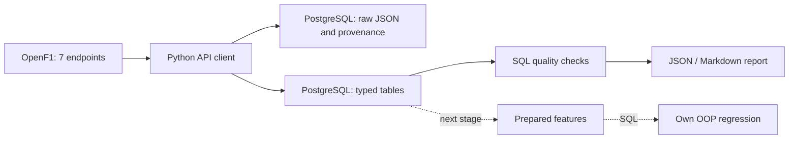

# F1 Lap Time Prediction

Учебная практика: **«Анализ и прогнозирование времени прохождения круга в гонках Формулы-1 с учётом характеристик шин и погодных условий»**.

Реализован **этап 1: сбор реальных данных OpenF1, хранение в PostgreSQL и проверка качества**. Подготовка финальной выборки, собственная регрессия и метрики прогнозирования относятся к следующим этапам и пока не реализованы.

## Проверенные данные

Выбрана трасса **Circuit de Barcelona-Catalunya**, Гран-при Испании 2023–2025. Сначала проверена гонка 2024 года, затем получены остальные две. Одна трасса уменьшает различия длины и конфигурации; с 2023 года используется вариант без заключительной шиканы. Три гонки дают ограниченный набор независимых условий, несмотря на тысячи кругов.

| Год | session_key | Пилоты в источнике | Круги | Отрезки на шинах | Погода | События |
|---|---:|---:|---:|---:|---:|---:|
| 2023 | 9102 | 20 | 1312 | 63 | 154 | 49 |
| 2024 | 9539 | 20 | 1310 | 62 | 154 | 107 |
| 2025 | 9971 | 19 | 1204 | 73 | 155 | 102 |
| Всего | | 59 записей пилот–сессия | **3826** | **198** | **463** | **258** |

Это **исходные круги**, а не готовая обучающая выборка. Пять кругов имеют отсутствующее время, три — отсутствующее начало. В 2025 году два незавершённых круга не соответствуют отрезку на шинах. В погоде 2024 есть один замер `rainfall=1` (13:06:38.206 UTC), поэтому весь набор нельзя автоматически объявить полностью сухим: на этапе 2 понадобится временная фильтрация. Исходные значения сохранены без подстановок.

19 пилотов в 2025 году согласуются с [выбытием Lance Stroll до старта](https://www.formula1.com/en/latest/article/official-grid-2025-spanish-grand-prix-stroll-tsunoda.5qQjXn0pciCrK2p9TOh65a). Это не потеря одного пилота при загрузке.

Подробные профили, диапазоны, пропуски, частоты и происхождение: [отчёт](reports/quality.md), [машиночитаемые результаты](reports/quality.json). Проверка повторной загрузки: [repeat_load.json](reports/repeat_load.json). При неизменных ответах источника количества предметных строк сохраняются; журнал запросов при повторе закономерно растёт.

## Пайплайн



Семь источников: `meetings`, `sessions`, `drivers`, `laps`, `stints`, `weather`, `race_control`. Каждая гонка загружается атомарно. HTTP 429, сетевые ошибки и 5xx обрабатываются ограниченными повторами; другие 4xx завершают запрос. Сохраняются URL, параметры, время получения UTC, SHA-256, число попыток и полный исходный ответ.

## Запуск

Python 3.11+; проверено на Python 3.12 и PostgreSQL 16. Команды выполняются из корня этого репозитория.

```bash
python3 -m venv .venv
source .venv/bin/activate
python -m pip install -e '.[dev]'
cp .env.example .env
```

В `.env` задайте собственный `POSTGRES_PASSWORD` и тот же пароль в `DATABASE_URL`. Файл `.env` исключён из Git. Если пароль содержит специальные символы URL, закодируйте их в строке подключения.

**Вариант A — Docker:**

```bash
docker compose up -d --wait
```

Docker должен быть запущен. Compose публикует БД только на `127.0.0.1:55432`. На машине автора Docker daemon был выключен, поэтому фактически использован вариант B.

**Вариант B — установленный PostgreSQL (macOS/Linux):**

```bash
python scripts/local_postgres.py start
```

Скрипт использует `pg_config`, создаёт отдельный кластер в `.local/pgdata` и БД проекта. При первом запуске без `.env` генерирует локальный пароль. Другие базы не изменяются. На этой машине БД уже развёрнута на `127.0.0.1:55432`.

**Схема, сбор и проверка:**

```bash
f1-pipeline init-db
f1-pipeline collect --years 2024
f1-pipeline collect --years 2023 2024 2025 --verify-repeat
f1-pipeline quality
f1-pipeline counts
```

OpenF1 может вернуть ограничение частоты запросов: загрузчик учитывает `Retry-After` с ограничением ожидания и числа попыток. Если повторы исчерпаны, выполните команду позднее; завершённые гонки остаются в БД. Повтор той же гонки безопасен для количества строк при неизменном источнике. Изменения исходных ответов отражаются в журнале и проверке хешей; изменение или удаление события провайдером требует отдельного анализа.

## Работа с БД и DBeaver

Подключение: PostgreSQL, host `127.0.0.1`, port `55432`, database `f1_project`, user `f1`, пароль из локального `.env`. Схема `f1`.

- [SQL создания таблиц](sql/001_schema.sql)
- [Агрегированные проверки](sql/002_quality.sql)
- [Пример чтения кругов с шинами и прошлой погодой](sql/003_extract.sql)
- [ER-диаграмма и словарь данных](docs/database.md)
- [Соответствие требованиям практики](docs/practice_requirements.md)

Для отчёта практики откройте ER Diagram в DBeaver и сохраните скриншот: Mermaid-схема в README не заменяет требуемый скриншот интерфейса.

## Проверки

```bash
pytest -q -m 'not integration'
```

Для интеграционных тестов укажите `TEST_DATABASE_URL`, ведущий на **отдельную тестовую БД с именем, заканчивающимся на `_test`**, затем выполните `pytest -q`. Тесты очищают только эту тестовую БД. Проверяются повторы загрузки, сохранение NULL, откат гонки при ошибке связей, дубли источника и SQL-отчёт качества. Синтетические записи существуют только в тестах.

## Структура

```text
src/f1_pipeline/     API, БД, сбор, проверки, CLI
sql/                DDL и воспроизводимые запросы
docs/               схема, словарь, требования, ограничения
reports/            фактические результаты проверок
tests/              HTTP и PostgreSQL проверки
scripts/            локальная инфраструктура
notebooks/          воспроизводимая проверка через SQL
```

## Источники и ограничения

[OpenF1](https://openf1.org/docs/) — неофициальный проект, предоставляющий исторические данные с 2023 года. Этот репозиторий не связан с Formula 1, FIA или командами. Код клиента и схема воспроизводят загрузку; большие исходные выгрузки и локальная БД в Git не публикуются. Условия доступа провайдера и права на данные следует проверять отдельно; доступность API не означает передачу прав на все исходные данные.

Время начала круга приблизительно. `SOFT/MEDIUM/HARD` не является неизменным физическим составом между уикендами. Топливо и все решения пилота не наблюдаются; связи с пробегом шин нельзя трактовать как чистую причинную деградацию. Модель следующего этапа будет проверяться на отдельных более поздних гонках с признаками, доступными до начала круга.
