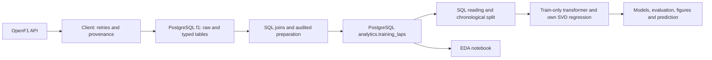
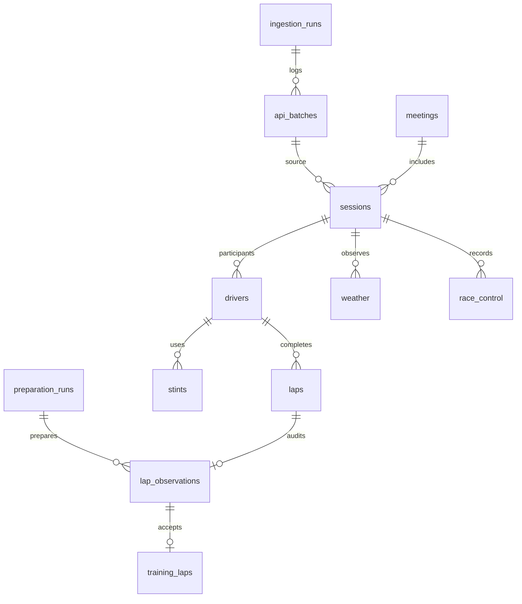

# F1 Lap Time Prediction

**Анализ и прогнозирование времени прохождения круга в гонках Формулы-1 с учётом характеристик шин и погодных условий.**

Учебный проект с полным пайплайном: реальные данные OpenF1 → PostgreSQL → проверенная выборка → собственная множественная линейная регрессия на ООП → обучение и временная проверка. Обучение, оценка и исторический прогноз читают данные из PostgreSQL через SQL.

На тестовой гонке 2025 года выбранная регрессия получила **MAE 0.8525 с**. Прогноз по среднему последних корректных кругов оказался точнее: **0.6576 с**. Результат сохранён без подбора параметров под итоговый тест.

[Результаты](reports/modeling/results.md) · [Материалы для защиты](docs/defense.md) · [Отчёт DOCX](docs/practice_report.docx) · [Отчёт PDF](docs/practice_report.pdf) · [Проверка воспроизведения](reports/final_verification.json) · [CI](https://github.com/geeksetter/f1-lap-time-prediction/actions)

## Что прогнозируется

Длительность одного обычного сухого круга конкретного пилота, прогнозируемая **до начала этого круга**. Область проекта — Circuit de Barcelona-Catalunya и гонки 2023–2025. Одна трасса уменьшает различия конфигурации; с 2023 года применяется [вариант без последней шиканы](https://corp.formula1.com/formula-1-aws-gran-premio-de-espana-2023-changes-its-track-configuration/).

Отбор обычных кругов использует события, известные после их завершения. Поэтому метрики условны: они относятся к кругам, оказавшимся обычными и сухими, и не оценивают способность заранее предсказывать пит-стопы, аварии или дождь. Команда `predict` воспроизводит исторический прогноз по допустимым признакам; потоковый сервис live-гонки не реализован.

## Данные и очистка

Источник — [OpenF1](https://openf1.org/docs/), семь endpoints: meetings, sessions, drivers, laps, stints, weather, race_control. UTC, исходные NULL, JSON и происхождение каждого запроса сохраняются в БД.

| Год | Сессия | Пилот–сессия | Исходные круги | Stints | Погода | События | Принятые круги |
|---|---:|---:|---:|---:|---:|---:|---:|
| 2023 | 9102 | 20 | 1312 | 63 | 154 | 49 | 1207 |
| 2024 | 9539 | 20 | 1310 | 62 | 154 | 107 | 1166 |
| 2025 | 9971 | 19 | 1204 | 73 | 155 | 102 | 989 |
| Всего | 3 | 59 | **3826** | 198 | 463 | 258 | **3362** |

Исключено **464 круга, 12.13%**. Причины сохраняются для каждой строки: первый круг, pit-in/out, SC/VSC, красный/жёлтый флаг, дождь, отсутствующие или невалидные обязательные значения. Медленные круги без формального основания сохраняются. Причины могут пересекаться, поэтому их количества нельзя складывать как число исключений.

Пять исходных кругов не имеют длительности, три — времени начала. В 2025 два незавершённых круга не сопоставляются с stint. Один дождевой погодный замер 2024 года учитывается при отборе. 19 пилотов в 2025 согласуются с [выбытием Stroll до старта](https://www.formula1.com/en/latest/article/official-grid-2025-spanish-grand-prix-stroll-tsunoda.5qQjXn0pciCrK2p9TOh65a).

Возраст перед кругом: `tyre_age_at_start + lap_number - lap_start`. Погода — последний замер той же сессии с `weather_at <= lap_start_at`, давность не более 120 секунд. Сектора и телеметрия прогнозируемого круга не входят в модель. [Правила очистки](docs/preparation.md), [словарь признаков и момент доступности](docs/features.md), [числа исключений](reports/cleaning.md), [профиль исходных данных](reports/quality.md).

## Архитектура и ER





Связи выше сокращены для чтения. Полный DDL с PK/FK и индексами — [001_schema.sql](sql/001_schema.sql), [004_preparation_schema.sql](sql/004_preparation_schema.sql). Словарь типов и единиц — [database.md](docs/database.md). Исходные таблицы `f1` отделены от производных `analytics`; повтор загрузки не создаёт предметные дубли, повтор подготовки проверяет хеши, а журналы запусков растут для аудита. События без ID идентифицируются хешем исходной записи; исправления и удаления провайдером требуют отдельного исследования.

Для учебного отчёта нужен дополнительный скриншот ER из DBeaver. Управление приложением было недоступно при финальной проверке; [инструкция](docs/defense.md#скриншот-dbeaver) позволяет получить его из существующей БД. Mermaid не выдан за скриншот DBeaver.

## Собственная модель и проверка

`MultipleLinearRegression` реализует `fit`, `predict`, `save`, `load`, свободный член и проверку входов. Обучение — OLS через явную SVD-псевдообратную: `A = [1, X]`, `β = V Σ⁺ Uᵀ y`. NumPy используется для линейной алгебры; готовая регрессия sklearn не используется. Сингулярные значения ниже численного порога исключаются. [Реализация](src/f1_pipeline/regression.py), [математическое обоснование](docs/modeling.md).

Числовые медианы, средние и стандартные отклонения вычисляются только на fit-данных. Категории кодируются K−1 центрированными индикаторами; неизвестная категория получает средний тренировочный эффект. Параметры, модели, хеши входов и разбиение сохраняются.

**2023 — train, 2024 — validation, 2025 — final test.** По валидации выбран набор с шинами, затем модели переобучены на 2373 кругах 2023+2024. Соседние круги между выборками не перемешиваются. Базовые прогнозы используют только завершённые прошлые обычные круги того же пилота и сессии; при отсутствии истории применяется сохранённое среднее fit-целей. Все методы сравниваются на одинаковых строках.

| Метод | Test n | MAE, с | RMSE, с | R² |
|---|---:|---:|---:|---:|
| Пилот и номер круга | 989 | 0.9300 | 1.2084 | 0.2870 |
| + состав и пробег шин, выбранная регрессия | 989 | **0.8525** | **1.1262** | **0.3806** |
| + температура воздуха и трассы | 989 | 0.8567 | 1.1302 | 0.3763 |
| Последний корректный круг | 989 | 0.6587 | 1.0469 | 0.4648 |
| Среднее последних 1–3 корректных кругов | 989 | **0.6576** | **1.0069** | **0.5049** |

MAE/RMSE/R² независимо перепроверены SQL по целям БД. Adjusted R² применяется только к полному in-sample OLS при полном ранге и `n > p+1`; для выбранной модели он равен 0.6996. Он не заменяет временный тест и не доказывает значимость при зависимости кругов.

## Запуск с нуля

Нужны Git, **Python 3.12** и PostgreSQL 16 либо работающий Docker. Команды ниже для macOS/Linux; в PowerShell активация — `.venv\Scripts\Activate.ps1`. Проверенные зависимости закреплены в lock-файле, macOS-пакет appnope имеет платформенный marker.

```bash
git clone https://github.com/geeksetter/f1-lap-time-prediction.git
cd f1-lap-time-prediction
python3.12 -m venv .venv
source .venv/bin/activate
python -m pip install -r requirements.lock.txt
python -m pip install --no-deps -e .
python scripts/configure_env.py
```

Последняя команда создаёт приватный `.env` со случайным паролем и согласованным `DATABASE_URL`, не печатает секрет и не перезаписывает существующий файл. Образец параметров — `.env.example`. Если порт занят, при первом создании используйте `python scripts/configure_env.py --port 55433`. Существующую конфигурацию редактируйте локально; специальные символы собственного пароля кодируйте в URL.

**Выберите один способ запуска PostgreSQL.**

```bash
# Docker с запущенным daemon
docker compose up -d --wait

# ИЛИ установленный PostgreSQL 16: pg_config должен быть в PATH
python scripts/local_postgres.py start
```

Локальный скрипт создаёт собственный кластер `.local/pgdata` и БД, не управляет чужими кластерами. Compose публикует порт только на loopback. Нативный путь фактически проверен с новым кластером; локальный Docker daemon был выключен. Интеграционный CI использует контейнер PostgreSQL 16.

```bash
f1-pipeline init-db
f1-pipeline collect --years 2023 2024 2025 --country Spain --circuit Catalunya --verify-repeat
f1-pipeline quality --output .local/reports
f1-pipeline prepare --years 2023 2024 2025 --circuit Catalunya --output .local/reports --verify-repeat
f1-pipeline eda --output .local/reports
f1-pipeline train --output .local/experiment
f1-pipeline evaluate --artifacts .local/experiment --output .local/reports/modeling
f1-pipeline predict --artifacts .local/experiment --session 9971 --driver 1 --lap 40
```

Пример прогноза: **78.9070 с**, с погодой до начала круга. Вход — SQL из БД, а не опубликованные CSV. Новый каталог `.local/experiment` позволяет заново обучить модель; `artifacts/stage3` хранит опубликованный замороженный эксперимент и защищён от незаметного подбора после теста. При изменении источника сравнивайте новые отчёты с опубликованными и объясняйте отличия. Повтор сбора записывает `reports/repeat_load.json`, остальные локальные результаты — в `.local`.

Клиент ограничивает частоту запросов, учитывает 429 и Retry-After, имеет timeout и ограниченные повторы. Для загрузки нужен Интернет и доступность OpenF1; тесты API используют фиктивные ответы.

```bash
python scripts/check_notebook.py notebooks/01_data_quality.ipynb
python scripts/check_notebook.py notebooks/02_preparation_eda.ipynb
pytest -q -m 'not integration'
```

Ноутбуки исполняются с SQL-чтением PostgreSQL. Для PyCharm/VS Code выберите `.venv`. Интеграционные тесты требуют отдельной БД, **имя которой заканчивается на `_test`**, и `TEST_DATABASE_URL`; они очищают только её. [Безопасный запуск тестовой БД](docs/reproduction.md). GitHub Actions разделён на offline и PostgreSQL jobs; оба обходятся без реального OpenF1.

Для пересборки редактируемого отчёта из Markdown и локальных фигур:

```bash
python -m pip install -e '.[report]'
python scripts/build_practice_report.py
```

PDF можно экспортировать из Word или LibreOffice. Готовые DOCX/PDF уже приложены; числовые результаты генератор не переобучает.

## Графики


Распределения показывают разные центры и правый хвост. Медленные круги сохранены. Ещё три разных типа — динамика, boxplot составов и scatter температуры — находятся в [EDA](reports/eda.md) и [выполненном ноутбуке](notebooks/02_preparation_eda.ipynb).


Отклонения от диагонали показывают ошибки, включая крупные. Остатки и ошибки по всем пилотам и шинам — в [результатах модели](reports/modeling/results.md).

## Ограничения и развитие

Три гонки не дают широкого независимого покрытия. Все 989 тестовых кругов имеют температуры за диапазонами fit; 317 кругов принадлежат неизвестным при обучении пилотам. HARD в 2025 представлен шестью кругами одного пилота. Возраст шин измеряет пробег, а не физический износ; составы SOFT/MEDIUM/HARD относительны для уикенда. Топливо, трафик и изменения машины не контролируются. Наблюдаемые связи не являются причинным эффектом шин или погоды.

`date_start` приблизителен; задержка публикации API не моделируется. Базовые методы используют завершённые круги тестовой гонки последовательно. EDA ранее показал тестовую гонку автору, поэтому тест отложен от обучения и выбора, но не полностью слепой для человека. Новые улучшения требуют другой заранее выделенной гонки, а не настройки по уже изученному тесту.

Дальнейшая работа: дополнительные сухие гонки той же конфигурации, новая временная проверка, признаки прошлых кругов в регрессии, раздельная оценка после смены шин, нелинейности и взаимодействия. Улучшения пока не объявляются выполненными.

## Публикация и материалы практики

В Git сохранены история этапов, код, SQL, зависимости, тесты, документы, графики и небольшие производные результаты. `.env`, токены, виртуальная среда, PostgreSQL, IDE-настройки и полные API-выгрузки исключены. Происхождение и ограничения использования — [DATA_USAGE.md](DATA_USAGE.md); лицензия собственного кода отдельно от прав на исходные спортивные данные.

[Матрица требований](docs/practice_requirements.md), [памятка защиты и вопросы](docs/defense.md), [отчёт](docs/practice_report.pdf), [техническое воспроизведение](docs/reproduction.md). Титульные реквизиты, подписи, индивидуальное задание, рабочий график и согласование преподавателем оформляются студентом; они не выданы за выполненные проектом действия.

```text
src/f1_pipeline/  клиент, БД, очистка, EDA, собственная модель, CLI
sql/             DDL, подготовка, чтение обучающей выборки
notebooks/       выполненные исследования через SQL
reports/         качество, очистка, EDA, метрики и проверки
artifacts/stage3/ замороженные модели, преобразования, входы и прогнозы
docs/            словари, методика, защита и отчёт
scripts/         инфраструктура и запуск ноутбуков
tests/           offline и PostgreSQL проверки
```
