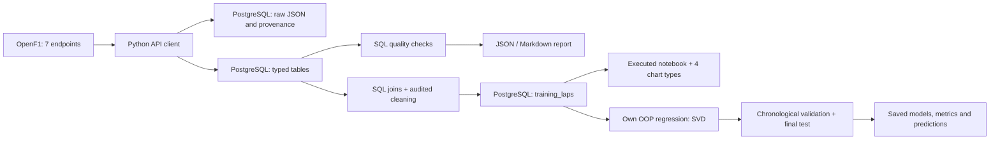

# F1 Lap Time Prediction

Учебная практика: **«Анализ и прогнозирование времени прохождения круга в гонках Формулы-1 с учётом характеристик шин и погодных условий»**.

Реализованы **этап 1: сбор OpenF1 и PostgreSQL**, **этап 2: подготовка и EDA**, **этап 3: собственная ООП-регрессия, обучение и проверка прогноза**.

## Проверенные данные

Выбрана трасса **Circuit de Barcelona-Catalunya**, Гран-при Испании 2023–2025. Сначала проверена гонка 2024 года, затем получены остальные две. Одна трасса уменьшает различия длины и конфигурации; [с 2023 года используется вариант без заключительной шиканы](https://corp.formula1.com/formula-1-aws-gran-premio-de-espana-2023-changes-its-track-configuration/). Три гонки дают ограниченный набор независимых условий, несмотря на тысячи кругов.

| Год | session_key | Пилоты в источнике | Круги | Отрезки на шинах | Погода | События |
|---|---:|---:|---:|---:|---:|---:|
| 2023 | 9102 | 20 | 1312 | 63 | 154 | 49 |
| 2024 | 9539 | 20 | 1310 | 62 | 154 | 107 |
| 2025 | 9971 | 19 | 1204 | 73 | 155 | 102 |
| Всего | | 59 записей пилот–сессия | **3826** | **198** | **463** | **258** |

Это **исходные круги**. Пять кругов имеют отсутствующее время, три — отсутствующее начало. В 2025 году два незавершённых круга не соответствуют отрезку на шинах. В погоде 2024 есть один замер `rainfall=1` (13:06:38.206 UTC), поэтому весь набор нельзя автоматически объявить полностью сухим. На этапе 2 выполнена временная фильтрация; исходные значения сохранены без подстановок.

19 пилотов в 2025 году согласуются с [выбытием Lance Stroll до старта](https://www.formula1.com/en/latest/article/official-grid-2025-spanish-grand-prix-stroll-tsunoda.5qQjXn0pciCrK2p9TOh65a). Это не потеря одного пилота при загрузке.

Подробные профили, диапазоны, пропуски, частоты и происхождение: [отчёт](reports/quality.md), [машиночитаемые результаты](reports/quality.json). Проверка повторной загрузки: [repeat_load.json](reports/repeat_load.json). При неизменных ответах источника количества предметных строк сохраняются; журнал запросов при повторе закономерно растёт.

## Пайплайн



Семь источников: `meetings`, `sessions`, `drivers`, `laps`, `stints`, `weather`, `race_control`. Каждая гонка загружается атомарно. HTTP 429, сетевые ошибки и 5xx обрабатываются ограниченными повторами; другие 4xx завершают запрос. Сохраняются URL, параметры, время получения UTC, SHA-256, число попыток и полный исходный ответ.

## Запуск

Python 3.11+; проверено на Python 3.12 и PostgreSQL 16. Команды выполняются из корня этого репозитория.

```bash
python3 -m venv .venv
source .venv/bin/activate
python -m pip install -e '.[dev]'
cp .env.example .env
```

В `.env` задайте собственный `POSTGRES_PASSWORD` и тот же пароль в `DATABASE_URL`. Файл `.env` исключён из Git. Если пароль содержит специальные символы URL, закодируйте их в строке подключения.

**Вариант A — Docker:**

```bash
docker compose up -d --wait
```

Docker должен быть запущен. Compose публикует БД только на `127.0.0.1:55432`. На машине автора Docker daemon был выключен, поэтому фактически использован вариант B.

**Вариант B — установленный PostgreSQL (macOS/Linux):**

```bash
python scripts/local_postgres.py start
```

Скрипт использует `pg_config`, создаёт отдельный кластер в `.local/pgdata` и БД проекта. При первом запуске без `.env` генерирует локальный пароль. Другие базы не изменяются. На этой машине БД уже развёрнута на `127.0.0.1:55432`.

**Схема, сбор и проверка:**

```bash
f1-pipeline init-db
f1-pipeline collect --years 2024
f1-pipeline collect --years 2023 2024 2025 --verify-repeat
f1-pipeline quality
f1-pipeline counts
```

OpenF1 может вернуть ограничение частоты запросов: загрузчик учитывает `Retry-After` с ограничением ожидания и числа попыток. Если повторы исчерпаны, выполните команду позднее; завершённые гонки остаются в БД. Повтор той же гонки безопасен для количества строк при неизменном источнике. Изменения исходных ответов отражаются в журнале и проверке хешей; изменение или удаление события провайдером требует отдельного анализа.

## Работа с БД и DBeaver

Подключение: PostgreSQL, host `127.0.0.1`, port `55432`, database `f1_project`, user `f1`, пароль из локального `.env`. Схема `f1`.

- [SQL создания таблиц](sql/001_schema.sql)
- [Агрегированные проверки](sql/002_quality.sql)
- [Пример чтения кругов с шинами и прошлой погодой](sql/003_extract.sql)
- [ER-диаграмма и словарь данных](docs/database.md)
- [Соответствие требованиям практики](docs/practice_requirements.md)

Для отчёта практики откройте ER Diagram в DBeaver и сохраните скриншот: Mermaid-схема в README не заменяет требуемый скриншот интерфейса.

## Этап 2: выборка и EDA

```bash
f1-pipeline prepare --verify-repeat
f1-pipeline eda
python scripts/check_notebook.py notebooks/02_preparation_eda.ipynb
```

Для ноутбука предварительно установите `python -m pip install -e '.[notebook]'`. Подготовка использует SQL из PostgreSQL; наборы CSV/JSON не являются входом. Схема `analytics` создаётся автоматически.

| Год | Исходные круги | Приняты | Исключены | Доля исключений |
|---|---:|---:|---:|---:|
| 2023 | 1312 | 1207 | 105 | 8.00% |
| 2024 | 1310 | 1166 | 144 | 10.99% |
| 2025 | 1204 | 989 | 215 | 17.86% |
| Всего | 3826 | **3362** | **464** | **12.13%** |

`analytics.lap_observations` содержит все круги и все причины отбора. `analytics.training_laps` — отдельная таблица принятых кругов с уникальным ключом сессия/пилот/круг. Погода сопоставлена только до старта; возраст шин исключает текущий ещё не пройденный круг. Повтор атомарно заменяет текущий производный набор и оставляет журнал происхождения. Причины pit-in, SC/VSC, флагов и дождя во время круга ретроспективны и не являются признаками модели. Медленные круги не удаляются по квантилям.

- [Правила, формула шин, происхождение и ER](docs/preparation.md)
- [Словарь признаков и момент доступности](docs/features.md)
- [Очистка с числами и долями](reports/cleaning.md)
- [EDA: гистограмма, линия, boxplot, scatter и выводы](reports/eda.md)
- [Выполненный ноутбук через PostgreSQL](notebooks/02_preparation_eda.ipynb)
- [Подтверждение повторения](reports/repeat_preparation.json)
- [Проверки этапа 2: тесты, БД и выполненный ноутбук](reports/stage2_verification.json)

Погодных сценариев всего три; HARD в очищенной гонке 2025 представлен только шестью кругами одного пилота. Выводы о причинном влиянии шин/температуры по этим данным делать нельзя. На этапе 2 параметры кодирования/масштабирования не обучаются; этап 3 вычисляет их только на fit-данных.

## Этап 3: собственная модель и итоговый тест

```bash
f1-pipeline train
f1-pipeline evaluate
f1-pipeline predict --session 9971 --driver 1 --lap 40
```

Вход обучения и проверки — PostgreSQL через SQL. `MultipleLinearRegression` вычисляет OLS-решение через явную SVD-псевдообратную формулу, имеет `fit/predict/save/load` и свободный член. sklearn не используется. Преобразования чисел и категорий обучаются только на fit-строках и сохраняются с моделью; неизвестные категории имеют явную обработку.

2023 — train (1207 кругов), 2024 — validation (1166), 2025 — final test (989). По валидации выбран набор `tyres`; после выбора модели переобучены на 2023+2024. Тест не читался при выборе. Соседние круги не перемешиваются. Повторный запуск оценивает замороженный эксперимент.

| Метод | Test n | MAE, с | RMSE, с | R² |
|---|---:|---:|---:|---:|
| Базовые признаки: пилот, номер круга | 989 | 0.9300 | 1.2084 | 0.2870 |
| + Состав и пробег шин — выбранная регрессия | 989 | 0.8525 | 1.1262 | 0.3806 |
| + Погода | 989 | 0.8567 | 1.1302 | 0.3763 |
| Последний корректный завершённый круг | 989 | 0.6587 | 1.0469 | 0.4648 |
| Среднее последних 1–3 корректных кругов | 989 | **0.6576** | **1.0069** | **0.5049** |

Регрессия уступает базовому прогнозу по прошлым кругам. Плохие прогнозы и медленные обычные круги не удалялись; параметры после теста не подбирались. Все температуры теста лежат вне fit-диапазонов, а 317 кругов принадлежат новым для модели пилотам. Эти ограничения и малое число гонок явно отражены в анализе.

- [Методика, математика и доступность истории](docs/modeling.md)
- [Фактические результаты и шесть графиков ошибок](reports/modeling/results.md)
- [Модели, параметры, прогнозы и границы выборок](artifacts/stage3)
- [Численная корректность и повторяемость](reports/stage3_verification.json)

## Проверки

```bash
pytest -q -m 'not integration'
```

Для интеграционных тестов укажите `TEST_DATABASE_URL`, ведущий на **отдельную тестовую БД с именем, заканчивающимся на `_test`**, затем выполните `pytest -q`. Тесты очищают только эту тестовую БД. Проверяются повторы загрузки, сохранение NULL, откат гонки при ошибке связей, дубли источника и SQL-отчёт качества. Синтетические записи существуют только в тестах.

Тесты проверяют сбор, подготовку, SVD на известном решении и вырожденной матрице, сериализацию, train-only преобразования, неизвестные категории, хронологическое разделение, корректную SQL-историю и отсутствие fit на тесте. 51 тест прошёл в локальном PostgreSQL; CI использует отдельную тестовую БД.

Ноутбук [01_data_quality.ipynb](notebooks/01_data_quality.ipynb) выполнен целиком с чтением из PostgreSQL. Для воспроизведения:

```bash
python -m pip install -e '.[notebook]'
python scripts/check_notebook.py
```

Для VS Code/PyCharm выберите интерпретатор `.venv`. Проверенные версии основных зависимостей закреплены в `requirements.lock.txt`; при точном воспроизведении установите их перед `pip install -e '.[dev]'`. GitHub Actions выполняет HTTP-тесты и интеграционные тесты в отдельном PostgreSQL 16 без обращения к реальному OpenF1.

## Структура

```text
src/f1_pipeline/     API, БД, сбор, проверки, CLI
sql/                DDL и воспроизводимые запросы
docs/               схема, словарь, требования, ограничения
reports/            фактические результаты проверок
tests/              HTTP и PostgreSQL проверки
scripts/            локальная инфраструктура
notebooks/          воспроизводимая проверка через SQL
```

## Источники и ограничения

[OpenF1](https://openf1.org/docs/) — неофициальный проект, предоставляющий исторические данные с 2023 года. Этот репозиторий не связан с Formula 1, FIA или командами. Код клиента и схема воспроизводят загрузку; большие исходные выгрузки и локальная БД в Git не публикуются. Условия доступа провайдера и права на данные следует проверять отдельно; доступность API не означает передачу прав на все исходные данные.

Время начала круга приблизительно. `SOFT/MEDIUM/HARD` не является неизменным физическим составом между уикендами. Топливо и все решения пилота не наблюдаются; связи с пробегом шин нельзя трактовать как чистую причинную деградацию. Модель следующего этапа будет проверяться на отдельных более поздних гонках с признаками, доступными до начала круга.
