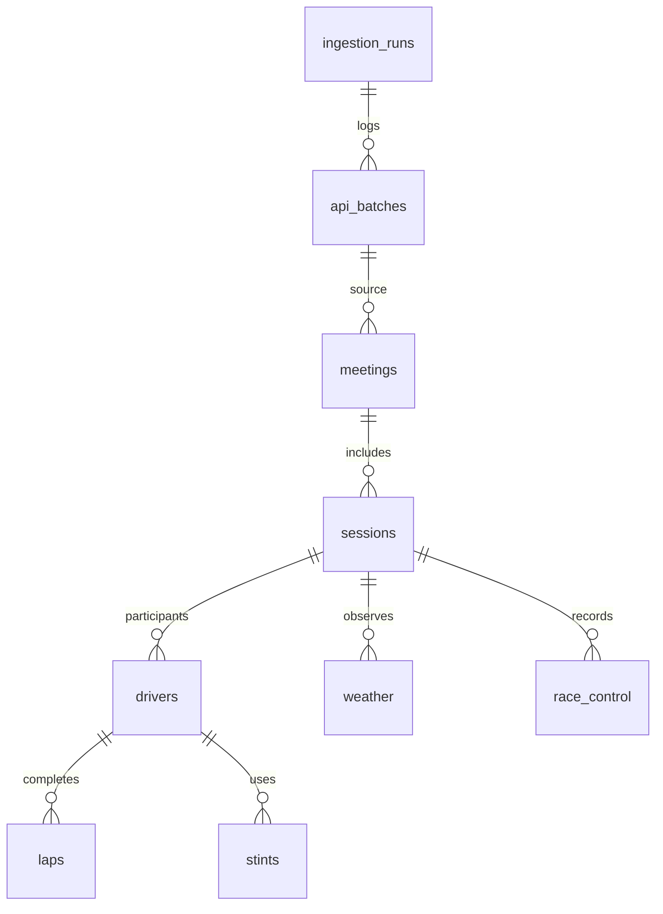

# Схема и словарь данных

Фактические внешние ключи перечислены в `sql/001_schema.sql`, включая связи каждой предметной таблицы с исходным batch и nullable-связь события с пилотом.

| Таблица | Гранулярность / первичный ключ |
|---|---|
| ingestion_runs | Один запуск для года и страны; UUID |
| api_batches | Один фактически полученный ответ; UUID |
| meetings | Уикенд; meeting_key |
| sessions | Сессия; session_key |
| drivers | Пилот в сессии; session_key + driver_number |
| laps | Круг; session_key + driver_number + lap_number |
| stints | Отрезок; session_key + driver_number + stint_number |
| weather | Замер; session_key + date |
| race_control | Уникальная исходная запись; session_key + event_id |

`event_id` — SHA-256 канонического JSON исходной записи: OpenF1 не предоставляет отдельный ID события. Изменённая запись события считается новой; точные повторы сохраняются только в сырых ответах. Коллизии хеша теоретически возможны. Клиент отвергает дубли естественных ключей, сохраняя аномальный ответ в журнале failed-run.

Все предметные таблицы имеют `raw_record JSONB` и `source_batch_id UUID`. `api_batches` содержит полный исходный ответ, endpoint, source_url, query_params, fetched_at UTC, row_count, attempts и content_sha256. История запросов растёт при повторном запуске; это аудит, а не дубли предметных наблюдений.

## Основные поля

| Поле | Тип PostgreSQL | Смысл / единица |
|---|---|---|
| meeting_key, session_key | integer | Идентификаторы OpenF1 |
| year | integer | Календарный год |
| circuit_key | integer | Идентификатор трассы |
| circuit_short_name, country_name, location | text | Категории расположения |
| meeting_name, session_name, session_type | text | Название и тип события |
| is_cancelled | boolean | Признак отмены |
| date_start, date_end, date, fetched_at | timestamptz | UTC; момент события или получения |
| driver_number | integer | Номер пилота внутри сессии, не постоянный ID человека |
| full_name, name_acronym, team_name | text | Имя, сокращение, команда |
| lap_number, stint_number | integer | Порядковый номер |
| lap_duration, duration_sector_1/2/3 | double precision | Секунды; NULL сохраняется |
| is_pit_out_lap | boolean | Круг выезда из боксов |
| lap_start, lap_end | integer | Границы отрезка в номерах кругов |
| compound | text | Относительный состав SOFT/MEDIUM/HARD и др. |
| tyre_age_at_start | integer | Пройденные круги комплекта до начала отрезка |
| air_temperature, track_temperature | double precision | °C |
| humidity | double precision | % |
| pressure | double precision | hPa |
| rainfall | integer | Наличие дождя 0/1, не количество миллиметров |
| wind_speed | double precision | м/с |
| wind_direction | integer | Градусы |
| category, flag, scope, message | text | Тип, флаг, область и текст события |
| sector | integer | Номер сектора события, если применимо |

Сектора и все прочие поля сохраняются как исходные наблюдения. Их присутствие в БД **не разрешает использовать их для прогноза того же круга до начала**. `003_extract.sql` — первоначальный пример сопоставления исходных кругов. Полная подготовка этапа 2 использует `005_prepare_candidates.sql`; чтение итоговой таблицы — `006_training_read.sql`. Схема `analytics`, отбор и ER описаны в [preparation.md](preparation.md), разрешённые признаки — в [features.md](features.md).

При обновлении предметного ключа сохраняется последняя полученная версия, более ранние версии доступны в api_batches.response. Удаления и исправления событий провайдером автоматически не синхронизируются: изменение хешей/числа строк необходимо исследовать отдельно. Failed-run не считается полным набором источников.
