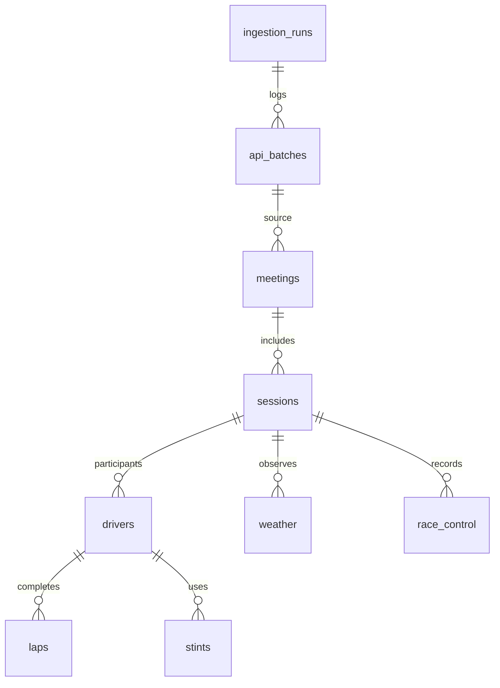
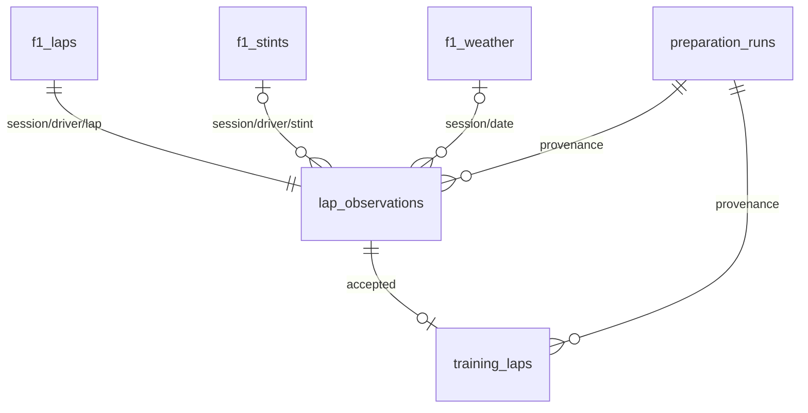
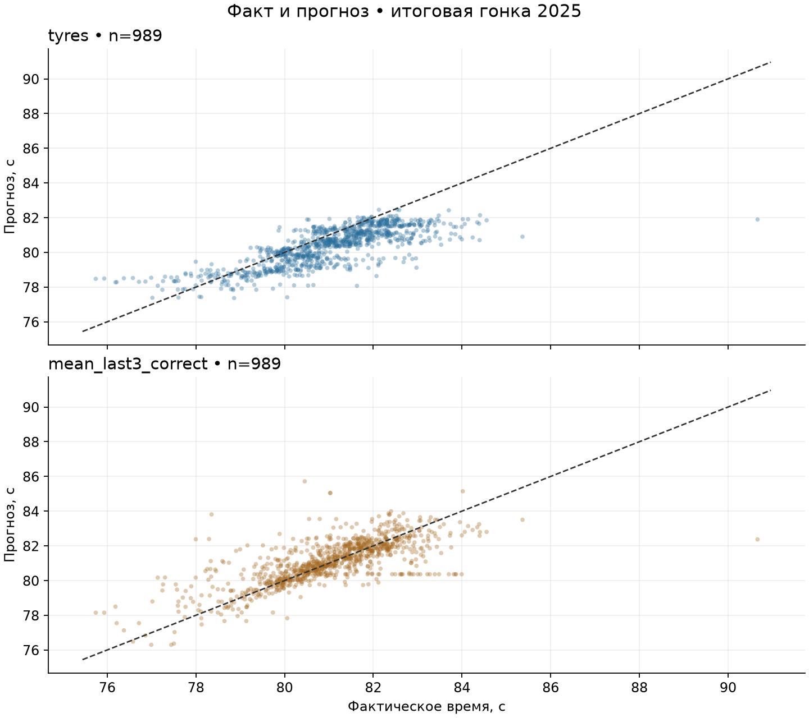
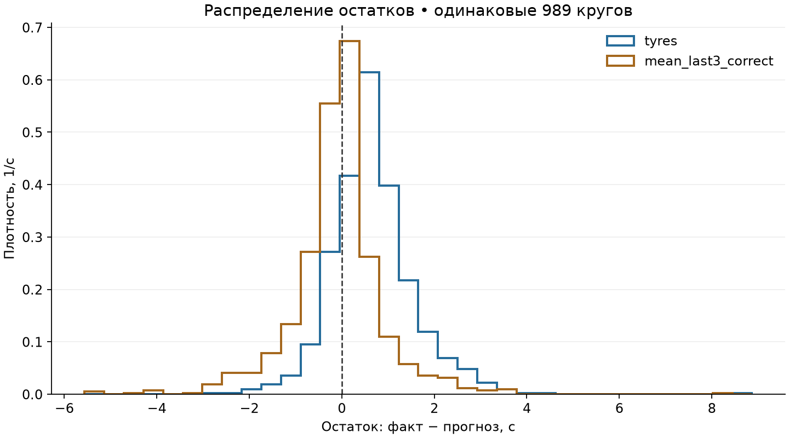
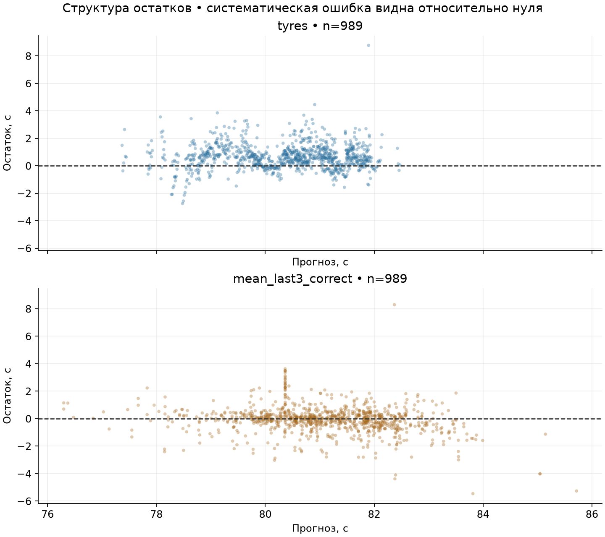
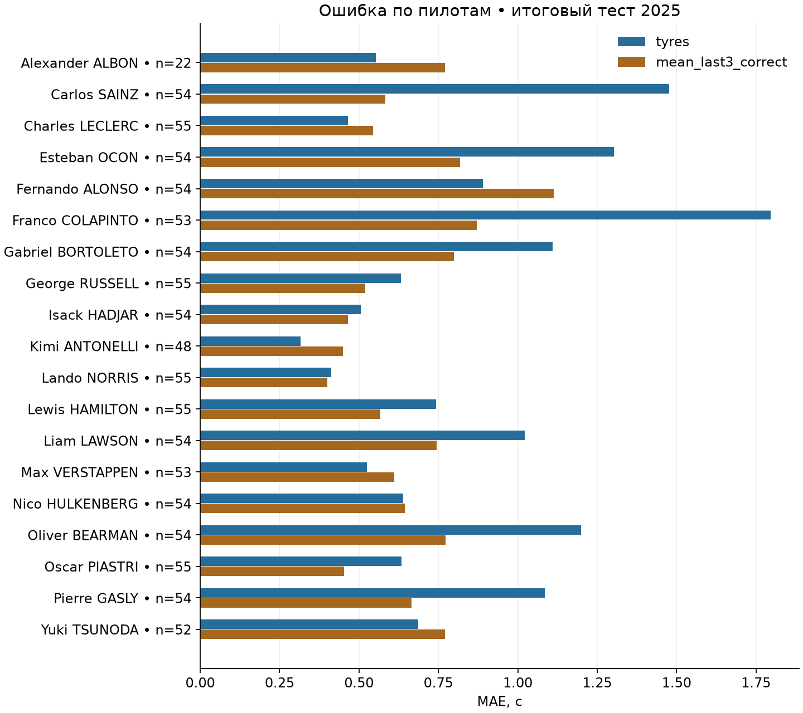
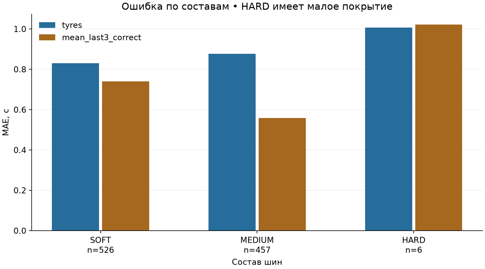
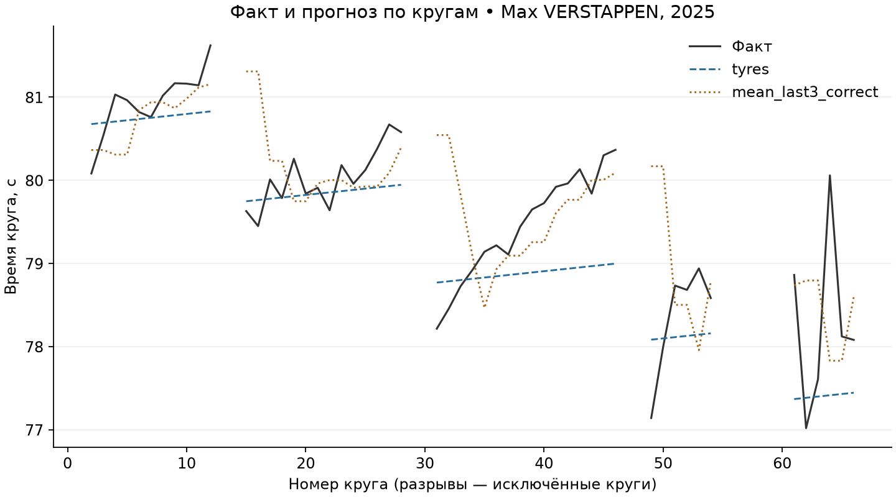

# Отчёт по учебной практике

Анализ и прогнозирование времени прохождения круга в гонках Формулы-1 с учётом характеристик шин и погодных условий

РТУ МИРЭА

Студент ____________________    Группа ____________________

Руководитель ____________________

Подпись студента ____________________

Подпись руководителя ____________________

Москва 2026

Техническое содержание подготовлено по выполненным расчётам. Индивидуальное задание, рабочий график и утверждение темы оформляются по формам кафедры. Документ требует заполнения реквизитов и проверки нормоконтроля перед сдачей.

<!-- pagebreak -->
# Аннотация

Источник данных — OpenF1, br-g и участники проекта, https://openf1.org/docs/. Данные нормализованы, объединены и отфильтрованы; построены собственные признаки и прогнозы. Производные результаты распространяются в части прав автора под CC BY-NC-SA 4.0, https://creativecommons.org/licenses/by-nc-sa/4.0/, без гарантии точности.

Работа рассматривает прогноз длительности обычного сухого круга до его начала на трассе Circuit de Barcelona-Catalunya. Выбран период 2023–2025. Реальные данные OpenF1 сохранены в PostgreSQL вместе с исходными ответами и метаданными происхождения. Сбор, подготовка, обучение, проверка и исторический прогноз объединены командами Python-проекта.

В источнике получено 3826 кругов. Подготовка сохранила 3362 наблюдения; для 464 исключений записаны причины. Реализованы четыре содержательных вида визуализации и собственный класс множественной линейной регрессии с обучением через SVD-псевдообратную. Кодирование и масштабирование вычисляются только по тренировочной части. Регрессии сравниваются с последовательными базовыми прогнозами на одних и тех же кругах.

Для обучения используется гонка 2023 года, для выбора признаков — 2024, для итоговой проверки — 2025. Выбранная регрессия с признаками шин получила на 989 тестовых кругах MAE 0.8525 с, RMSE 1.1262 с, R² 0.3806. Среднее последних корректных кругов оказалось точнее: MAE 0.6576 с. Перенос ограничен тремя гонками одной трассы, погодным сдвигом и новыми пилотами.

Рабочий результат включает публичный GitHub-репозиторий, SQL-схему и словари, аудит отбора, выполненные ноутбуки, замороженные модели и автоматические тесты. При повторении с новой venv и пустым PostgreSQL метрики совпали с исходными расчётами. Скриншот DBeaver, кафедральные формы и подписи остаются действиями студента. Причинный эффект шин и температуры по этому набору не утверждается.

<!-- pagebreak -->
# Содержание

Введение ........................................................................ 4

1 Сбор данных и первичный анализ ................................ 5

2 Визуализация данных .................................................. 20

3 Множественная линейная регрессия и проверка ............. 26

Заключение .................................................................... 43

Список использованных источников ................................ 44

Приложение А Компоненты и защита ................................ 46

Приложение Б Листинги собственной модели и SQL .......... 48

Номера соответствуют приложенному PDF. После заполнения кафедральных реквизитов и изменения оформления обновите содержание. Подразделы раскрыты в тексте; заголовки оформлены стилями Word.

<!-- pagebreak -->

# Введение

Актуальность работы связана с необходимостью корректно объединять данные из нескольких временных источников и оценивать прогноз на новых условиях. Гонки Формулы-1 дают числовую целевую переменную, сведения о пилотах, шинах и погоде. При этом техническая доступность данных не устраняет пропуски, приближённые timestamp и зависимость соседних кругов. Такие особенности позволяют проверить полный цикл анализа на реальной задаче.

Цель работы — построить воспроизводимый процесс получения и подготовки данных, реализовать собственную множественную линейную регрессию и измерить её качество при переносе на более позднюю гонку. Прогнозируемая величина — время прохождения одного обычного сухого круга в секундах, момент прогноза — начало этого круга.

Задачи включают автоматизированный сбор OpenF1; хранение в PostgreSQL с ключами и происхождением; SQL-сопоставление круга, шин и прошлой погоды; прозрачный аудит исключений; визуализацию; собственную модель на ООП; train-only преобразования; хронологическое сравнение с базовыми методами; публикацию кода и воспроизводимых результатов.

API выбран вместо ручного сбора для получения большого связанного набора с идентификаторами и датами. База данных служит обязательной промежуточной и аналитической областью: обучение читает SQL, а не готовую файловую выгрузку. Для уменьшения различий длины и конфигурации выбрана одна трасса; перенос между трассами в эту работу не входит.

Практическая ценность результата состоит в демонстрации воспроизводимой инженерии данных и проверяемой реализации модели. Работа не выдаётся за промышленный сервис гоночной стратегии. Превосходство регрессии над сильной последовательной базой не является заранее принятой предпосылкой и проверяется фактически.

# 1 Сбор данных и первичный анализ

## Объект и область исследования

Единица исходного анализа — круг пилота в Race-сессии. Идентификатор наблюдения состоит из session_key, driver_number и lap_number. Объект исследования — изменение длительности кругов и её описательная связь с доступными до начала круга характеристиками.

Выбраны испанские гонки 2023, 2024 и 2025 годов, session_key 9102, 9539 и 9971. С 2023 года Catalunya использует конфигурацию без последней шиканы [10]. Это уменьшает неоднородность конфигураций между годами. Однако машины, состав участников, программы шин и условия гонок меняются; одинаковая трасса не означает идентичный эксперимент.

В 2025 году источник содержит 19 участников; выбытие Lance Stroll до старта подтверждено официальной публикацией [11]. Отсутствие двадцатого участника не подменяется синтетическими строками. В 2024 имеется единичный дождевой замер; сухая область задаётся на уровне кругов, а не предположением о всей сессии.

## Процедура сбора

Запросы выполняются к https://api.openf1.org/v1. Источники — meetings, sessions, drivers, laps, stints, weather, race_control [1]. Сначала обнаруживается Race-сессия выбранного года, страны и трассы, затем запрашиваются относящиеся к ней записи. Полный ответ сохраняется в api_batches, нормализованные поля — в связанных предметных таблицах.

Клиент имеет timeout, ограниченное число попыток, журналирование и минимальный интервал запросов 2.1 секунды. 429, ошибки сети и 5xx допускают повтор; иные 4xx не маскируются. Сохраняются URL, параметры, UTC-время получения, число строк, число попыток и SHA-256. Это позволяет сопоставить расчёт с источником и обнаружить изменения ответа.

Загрузка каждой гонки атомарна. Естественные ключи предотвращают увеличение числа предметных строк при повторе; аудиторские записи намеренно пополняются. Проверяются обязательные endpoints, связи, дубли и область сессии. Исходные NULL сохраняются. Если загрузка не может завершиться, неполный запуск не считается полным покрытием.

Вывод: собран реальный связанный набор, а происхождение и повторяемость отделены от простой записи CSV. Исправления/удаления событий провайдером автоматически полностью не синхронизируются; проверка хешей требует содержательного анализа изменений.


## Схема и словарь данных



Фактические внешние ключи перечислены в `sql/001_schema.sql`, включая связи каждой предметной таблицы с исходным batch и nullable-связь события с пилотом.

| Таблица | Гранулярность / первичный ключ |
|---|---|
| ingestion_runs | Один запуск для года и страны; UUID |
| api_batches | Один фактически полученный ответ; UUID |
| meetings | Уикенд; meeting_key |
| sessions | Сессия; session_key |
| drivers | Пилот в сессии; session_key + driver_number |
| laps | Круг; session_key + driver_number + lap_number |
| stints | Отрезок; session_key + driver_number + stint_number |
| weather | Замер; session_key + date |
| race_control | Уникальная исходная запись; session_key + event_id |

`event_id` — SHA-256 канонического JSON исходной записи: OpenF1 не предоставляет отдельный ID события. Изменённая запись события считается новой; точные повторы сохраняются только в сырых ответах. Коллизии хеша теоретически возможны. Клиент отвергает дубли естественных ключей, сохраняя аномальный ответ в журнале failed-run.

Все предметные таблицы имеют `raw_record JSONB` и `source_batch_id UUID`. `api_batches` содержит полный исходный ответ, endpoint, source_url, query_params, fetched_at UTC, row_count, attempts и content_sha256. История запросов растёт при повторном запуске; это аудит, а не дубли предметных наблюдений.

### Основные поля

| Поле | Тип PostgreSQL | Смысл / единица |
|---|---|---|
| meeting_key, session_key | integer | Идентификаторы OpenF1 |
| year | integer | Календарный год |
| circuit_key | integer | Идентификатор трассы |
| circuit_short_name, country_name, location | text | Категории расположения |
| meeting_name, session_name, session_type | text | Название и тип события |
| is_cancelled | boolean | Признак отмены |
| date_start, date_end, date, fetched_at | timestamptz | UTC; момент события или получения |
| driver_number | integer | Номер пилота внутри сессии, не постоянный ID человека |
| full_name, name_acronym, team_name | text | Имя, сокращение, команда |
| lap_number, stint_number | integer | Порядковый номер |
| lap_duration, duration_sector_1/2/3 | double precision | Секунды; NULL сохраняется |
| is_pit_out_lap | boolean | Круг выезда из боксов |
| lap_start, lap_end | integer | Границы отрезка в номерах кругов |
| compound | text | Относительный состав SOFT/MEDIUM/HARD и др. |
| tyre_age_at_start | integer | Пройденные круги комплекта до начала отрезка |
| air_temperature, track_temperature | double precision | °C |
| humidity | double precision | % |
| pressure | double precision | hPa |
| rainfall | integer | Наличие дождя 0/1, не количество миллиметров |
| wind_speed | double precision | м/с |
| wind_direction | integer | Градусы |
| category, flag, scope, message | text | Тип, флаг, область и текст события |
| sector | integer | Номер сектора события, если применимо |

Сектора и все прочие поля сохраняются как исходные наблюдения. Их присутствие в БД **не разрешает использовать их для прогноза того же круга до начала**. `003_extract.sql` — первоначальный пример сопоставления исходных кругов. Полная подготовка этапа 2 использует `005_prepare_candidates.sql`; чтение итоговой таблицы — `006_training_read.sql`. Схема `analytics`, отбор и ER описаны в [preparation.md](preparation.md), разрешённые признаки — в [features.md](features.md).

При обновлении предметного ключа сохраняется последняя полученная версия, более ранние версии доступны в api_batches.response. Удаления и исправления событий провайдером автоматически не синхронизируются: изменение хешей/числа строк необходимо исследовать отдельно. Failed-run не считается полным набором источников.

## Покрытие и пропуски

| Год | Пилоты | Круги | Stints | Замеры погоды | События | Нет длительности | Нет начала |
|---|---:|---:|---:|---:|---:|---:|---:|
| 2023 | 20 | 1312 | 63 | 154 | 49 | 2 | 2 |
| 2024 | 20 | 1310 | 62 | 154 | 107 | 1 | 1 |
| 2025 | 19 | 1204 | 73 | 155 | 102 | 2 | 0 |
| Всего | 59 записей пилот–сессия | 3826 | 198 | 463 | 258 | 5 | 3 |

При первичном соединении 2025 обнаружены два круга без stint; пересечений stint нет. Погода до старта отсутствует у кругов без timestamp начала, который не восстанавливается предположениями. Для кругов с известным началом максимальная давность выбранной погоды около одной минуты, меньше заданного предела 120 с. Исходное и подготовленное покрытие различаются намеренно.

Вывод: обязательные источники присутствуют, но сырые круги нельзя без очистки считать обучающей выборкой. Пропуски целей, принадлежности к шинам и различия условий обрабатываются явно; исходные таблицы остаются неизменными.


## Числовые профили и частотные таблицы

Полные машинные результаты находятся в reports/quality.json. Следующие таблицы получены из выполненных SQL-агрегатов; статистики исходных кругов включают нестандартные круги и не являются метриками модели.

### laps.lap_duration

| Год | n | NULL | min | max | Среднее | Медиана | Мода |
|---|---:|---:|---:|---:|---:|---:|---:|
| 2023 | 1312 | 2 | 76.330 | 116.000 | 81.087 | 80.342 | 79.835 |
| 2024 | 1310 | 1 | 77.115 | 107.447 | 81.471 | 80.908 | 81.033 |
| 2025 | 1204 | 2 | 75.743 | 148.794 | 84.695 | 81.454 | 81.126 |

| Год | Дисперсия | Стандартное отклонение |
|---|---:|---:|
| 2023 | 15.6515 | 3.9562 |
| 2024 | 13.7697 | 3.7108 |
| 2025 | 114.3950 | 10.6956 |

### stints.tyre_age_at_start

| Год | n | NULL | min | max | Среднее | Медиана | Мода |
|---|---:|---:|---:|---:|---:|---:|---:|
| 2023 | 63 | 0 | 0.000 | 3.000 | 0.524 | 0.000 | 0.000 |
| 2024 | 62 | 0 | 0.000 | 8.000 | 0.758 | 0.000 | 0.000 |
| 2025 | 73 | 0 | 0.000 | 20.000 | 1.356 | 0.000 | 0.000 |

| Год | Дисперсия | Стандартное отклонение |
|---|---:|---:|
| 2023 | 1.2212 | 1.1051 |
| 2024 | 2.2848 | 1.5115 |
| 2025 | 7.0936 | 2.6634 |

### weather.air_temperature

| Год | n | NULL | min | max | Среднее | Медиана | Мода |
|---|---:|---:|---:|---:|---:|---:|---:|
| 2023 | 154 | 0 | 21.500 | 24.700 | 22.674 | 22.200 | 22.100 |
| 2024 | 154 | 0 | 23.600 | 24.700 | 24.132 | 24.100 | 24.100 |
| 2025 | 155 | 0 | 28.100 | 30.000 | 29.120 | 29.200 | 29.300 |

| Год | Дисперсия | Стандартное отклонение |
|---|---:|---:|
| 2023 | 0.8178 | 0.9043 |
| 2024 | 0.0388 | 0.1970 |
| 2025 | 0.1999 | 0.4471 |

### weather.track_temperature

| Год | n | NULL | min | max | Среднее | Медиана | Мода |
|---|---:|---:|---:|---:|---:|---:|---:|
| 2023 | 154 | 0 | 26.800 | 42.500 | 33.839 | 31.750 | 29.900 |
| 2024 | 154 | 0 | 38.300 | 43.600 | 41.096 | 41.150 | 41.800 |
| 2025 | 155 | 0 | 46.500 | 50.400 | 48.543 | 48.700 | 49.400 |

| Год | Дисперсия | Стандартное отклонение |
|---|---:|---:|
| 2023 | 25.1085 | 5.0108 |
| 2024 | 1.1219 | 1.0592 |
| 2025 | 0.9720 | 0.9859 |

### Частоты состава по отрезкам

| Год | Состав | Отрезков |
|---|---|---:|
| 2023 | HARD | 22 |
| 2023 | MEDIUM | 17 |
| 2023 | SOFT | 24 |
| 2024 | HARD | 13 |
| 2024 | MEDIUM | 19 |
| 2024 | SOFT | 30 |
| 2025 | HARD | 1 |
| 2025 | MEDIUM | 21 |
| 2025 | SOFT | 51 |

Единицы длительности — секунды, пробега — завершённые круги, температур — °C; дисперсия имеет квадрат соответствующей единицы. n включает все строки источника, числовые агрегаты рассчитаны по непустым значениям. Частоты выше относятся к отрезкам, а не к кругам; очищенное покрытие по кругам рассмотрено далее. Вывод: разброс исходных времён 2025 намного выше из-за нестандартных кругов; удаление таких режимов требует событийного основания, а не удаления правого хвоста ради метрик.

## Подготовка выборки: контракт и ограничения

Прогнозный момент — начало конкретного круга. Цель — его длительность **при условии, что круг оказался обычным и сухим**. Ретроспективный отбор не означает, что до старта можно предсказать будущий Safety Car или пит-стоп.

### Источник и время

Вход читается SQL из `f1.*`: [005_prepare_candidates.sql](../sql/005_prepare_candidates.sql). Файлы выгрузок не служат входом. PostgreSQL работает в UTC. Транзакция `REPEATABLE READ` обеспечивает согласованный снимок; advisory lock предотвращает параллельную замену подготовленных таблиц. Перед подготовкой проверяется наличие всех пяти обязательных источников для выбранных сессий. Таблицы источника остаются без изменений, что проверяется контрольными суммами всех полей.

Документация [OpenF1 / Stints](https://openf1.org/docs/#stints), проверена 14.10.2026: `tyre_age_at_start` — возраст шин на начало **отрезка**, выраженный в завершённых кругах. Поэтому

```text
tyre_age_before_lap = tyre_age_at_start + lap_number - lap_start
```

На начальном круге отрезка прибавляется ноль. У Расселла в сессии 9539: SOFT, круги 1–15, начальный возраст 3 → перед кругом 15 возраст 17; MEDIUM, начало 16, возраст 0 → перед 16 возраст 0, перед 17 возраст 1. Проверяется именно число пройденных кругов, а не физический износ резины. Все шесть реальных примеров записаны в [cleaning.md](../reports/cleaning.md).

Принадлежность отрезку определяется включительно по `lap_start..lap_end` и **по обоим ключам session_key/driver_number**. Число совпадений проверяется до загрузки. Пересечения отрезков прерывают подготовку; прежний набор сохраняется. `lap_end` применяется для сопоставления/аудита и не входит в признаки. Итоговые исторические stints не содержат времени объявления: предполагается, что команда знает состав и начальный возраст при установке шин. Задержки публикации OpenF1 проект не моделирует.

[OpenF1 / Laps](https://openf1.org/docs/#laps) описывает `date_start` как приблизительное время. [Weather](https://openf1.org/docs/#weather) обновляется примерно раз в минуту. Погодный SQL `LATERAL` выбирает максимум `date <= lap_start_at` в той же сессии; будущие записи никогда не используются. Максимальная давность 120 с — заранее заданный порог качества. Timestamp датчика сохраняется; timestamp не доказывает фактическую доступность сообщения API без задержки.

### Правила отбора

Все правила применяются независимо; причины сохраняются отсортированным массивом `exclusion_reasons`. Доли считаются от всех исходных кругов; суммы причин не равны числу исключённых строк из-за пересечений.

| Ситуация | Действие | Основание |
|---|---|---|
| Первый круг | Исключить | Стартовая процедура отличается от обычного темпа |
| Pit-out | Исключить | `is_pit_out_lap=true` |
| Pit-in | Исключить | Следующий круг той же пары session/driver отмечен pit-out **или** начинает следующий stint |
| Неизвестный pit-out | Исключить | Нет достоверного статуса |
| SC/VSC | Исключить пересекающий интервал круг | Состояние по сообщениям race_control |
| RED | Исключить до следующего GREEN на трассе | CLEAR не считается возобновлением после красного флага |
| YELLOW/DOUBLE YELLOW | Исключить пересекающий интервал круг | Состояние отдельного мини-сектора / трассы / пилота |
| BLUE, BLACK AND WHITE, CHEQUERED | Сохранить | Не доказывают ограничение обычного темпа; предупреждения/финиш сами по себе не причина удаления |
| Дождь | Исключить | rainfall=1 на начало или в течение круга; состояние до следующего замера |
| WET/INTERMEDIATE | Исключить | Дождевой состав |
| Нет времени круга / старта | Исключить | Цель/временное сопоставление не восстанавливаются догадками |
| Нет шин, погоды, температуры, имени пилота | Исключить | Не хватает обязательных признаков |
| Время ≤0, NaN/Infinity | Исключить | Невалидная цель, а не медленный результат |
| Возраст <0; температура воздуха вне −20..60 °C или трассы вне −20..80 °C | Исключить | Широкие физические проверки, заданные до обучения |
| Время вне 60..120 с | **Только предупреждение**, сохранить | Диапазон для просмотра, не фильтр качества модели |

Круг — полуоткрытый интервал `[lap_start_at, lap_start_at + lap_duration)`. Событие точно на конце не относится к этому кругу. Состояния race_control также полуоткрытые. Для кругов без цели конец не придумывается: они уже исключены по missing_target; полнота дополнительных причин пересечения для них не гарантируется.

Обработка [Race control](https://openf1.org/docs/#race-control): повторный жёлтый в том же scope не создаёт новую строку круга; CLEAR закрывает соответствующий сектор, GREEN с текстом PIT EXIT не сбрасывает состояния гонки. SC IN THIS LAP / VSC ENDING — предупреждения об окончании, состояние продолжается до последующего CLEAR/GREEN трассы или явного ENDED. Если закрытие отсутствует, интервал консервативно продолжается до конца сессии, `censored=true`. В 2025 году SC DEPLOYED в 14:17:01 UTC → IN THIS LAP в 14:27:16 → TRACK CLEAR в 14:28:21. Жёлтый сектор 12: 14:16:46–14:23:12 UTC. Интервалы и исходные ID сообщений находятся в отчёте и аудите.

Локальный жёлтый исключает все перекрывающиеся по времени круги, поскольку точная позиция автомобиля не используется. Это сознательно консервативная потеря данных, а не доказательство, что каждый пилот видел флаг. Пит-проезд без pit-out и без нового stint может остаться незамеченным. Rainfall=0 не доказывает сухой асфальт; один подозрительный дождевой замер 2024 года сохраняется как есть, а затронутые круги исключаются.

### Отдельные таблицы

- `analytics.preparation_runs`: успешные версии подготовки, параметры, контрольные суммы входа/выхода/кода, метаданные API-batch, результаты проверок. Ошибка откатывает транзакцию; успешный журнал растёт при повторе.
- `analytics.lap_observations`: **все** исходные круги с сопоставлениями, причинами, предупреждениями и ID race_control. Уникальный ключ `(session_key, driver_number, lap_number)`.
- `analytics.training_laps`: только принятые круги, целевая переменная, разрешённые признаки и временные следы проверки. Без текущих секторов, конца круга и причин исключения.

Подготовленные таблицы хранят **текущий** набор: повторный запуск атомарно заменяет их, не добавляя дубли. Журнал хранит контрольные суммы и происхождение предыдущих запусков, но не копии всех прошлых производных строк. Для воспроизведения старого набора требуются исходный снимок PostgreSQL, версия кода и конфигурация.



### Повторение и проверка

```bash
f1-pipeline prepare --verify-repeat
f1-pipeline eda
python scripts/check_notebook.py notebooks/02_preparation_eda.ipynb
```

`repeat_preparation.json` сравнивает вход, полный выход аудита и количества двух **фактических** запусков. Проверяются уникальность, кардинальность, согласование таблиц, FK, формула возраста, timestamp погоды/истории и вариативность по гонкам. `eda` дополнительно проверяет, что исходные данные не менялись после подготовки, и что прошлое время принадлежит тому же пилоту и сессии. Синтетические тесты проверяют будущую погоду, подмену цели/секторов, границы интервалов, SC/VSC/RED, межсессионную историю и атомарный отказ при пересечении stints.

Преобразования с обучаемыми параметрами здесь не применяются. При следующем этапе кодирование, заполнение отсутствующей истории и масштабирование обучаются только на тренировочных гонках. Предварительный план: 2023 train, 2024 validation, 2025 test. История предыдущих кругов доступна для последовательного прогноза перед каждым кругом; для прогноза всей гонки до её начала она недоступна. После изучения EDA финальный 2025 нельзя использовать для выбора модели/порогов.

## Словарь признаков и времени доступности

Таблица `analytics.training_laps`; одна строка — круг одного пилота одной сессии. Прогнозный момент `lap_start_at`. Разрешённый список задаётся `FEATURE_COLUMNS` в `prepare.py`; нельзя передавать модели все столбцы таблицы автоматически.

| Поле | Тип / единица | Роль | Когда доступно / источник |
|---|---|---|---|
| `compound` | text: SOFT/MEDIUM/HARD | Признак, категория | Установлен до круга; stints. Относительное обозначение, не конкретный C1..C5 |
| `tyre_age_before_lap` | integer, завершённые круги | Признак | Начальный возраст комплекта + ранее пройденные круги этого stint |
| `air_temperature` | float, °C | Признак | Последнее weather.date ≤ lap_start_at |
| `track_temperature` | float, °C | Признак | То же погодное наблюдение |
| `driver_name` | text | Признак, категория | Имя участника известно до гонки; driver_number не трактуется как числовая сила пилота |
| `lap_number` | integer, номер с 1 | Признак | Известен в момент начала круга; косвенно отражает этап гонки, не измеряет топливо |
| `previous_lap_duration` | float, секунды; nullable | Дополнительный признак | Последний ранее завершённый **исходный** круг этого же пилота в этой же сессии; конец ≤ текущего старта. Не обязательно соседний круг; возможны предыдущие pit/SC круги |
| `lap_duration` | float, секунды | **Цель, не признак** | Известна после завершения прогнозируемого круга |
| `session_key` | integer | Ключ / группировка | Идентификатор гонки; для разбиения, не значение признака |
| `driver_number` | integer | Ключ | Номер участника внутри сессии; идентичность — имя |
| `year` | integer | Метаданные разбиения | Известен заранее; не входит в основной список признаков |
| `lap_start_at` | timestamptz UTC | Момент прогноза / аудит | Приблизительный timestamp OpenF1 |
| `weather_at` | timestamptz UTC | Аудит доступности | Timestamp реально использованного погодного наблюдения |
| `weather_age_seconds` | float, секунды | Аудит качества | Разница старта и погодного timestamp, максимум 120 с |
| `previous_lap_number` | integer; nullable | Аудит истории | Номер круга, из которого взято предыдущее время |
| `previous_lap_end_at` | timestamptz UTC; nullable | Аудит истории | Его старт + длительность; строго ≤ текущего старта |
| `preparation_run_id` | uuid | Происхождение | Версия подготовки; не признак |

Дополнительные столбцы **только** `lap_observations`: `lap_end_at`, `stint_number`, `stint_lap_start`, `tyre_age_at_stint_start`, `rainfall_at_start`, `exclusion_reasons`, `warning_codes`, `race_control_event_ids`. Все причины и конец текущего круга ретроспективны. Rainfall применяется для отбора сухих кругов. Ни эти поля, ни sector durations/speeds/telemetry текущего круга не входят в модель.

Обязательные входы не заполняются выдуманными значениями: если их нет, круг исключается с причиной. NULL в дополнительной истории остаётся NULL до этапа обучения; заполнение по среднему/медиане допускается только после train-разбиения и обучения статистики на train.

Исторические OpenF1-записи могут быть пересмотрены, а приблизительные времена иногда не согласованы до миллисекунды. Поэтому ближайший предыдущий круг используется только при доказанном по имеющимся timestamp завершении. При пропуске соседнего круга аудит сохраняет `previous_completed_lap_not_adjacent`, позволяя проверить влияние этого допущения отдельно.

Категория пилота может быть новой в тестовой гонке: будущий кодировщик должен иметь явную обработку неизвестных имён. Цель проекта — отфильтрованный обычный круг; значение ошибки нельзя переносить на стартовые, дождевые, pit/SC круги или новую трассу.

## Подготовка обычных сухих кругов

Сформировано UTC: 2026-10-13 21:37:55.525722+00:00. Политика: `ordinary-dry-v1`.

Из 3826 кругов сохранено 3362; исключено 464 (12.13%).

Источник — PostgreSQL `f1.*`; все исходные записи сохранены. Итоговая оценка модели будет относиться к ретроспективно отобранным обычным сухим кругам, а не ко всем кругам гонки.

| Год | Исходные | Сохранены | Исключены | Доля |
|---|---:|---:|---:|---:|
| 2023 | 1312 | 1207 | 105 | 8.00% |
| 2024 | 1310 | 1166 | 144 | 10.99% |
| 2025 | 1204 | 989 | 215 | 17.86% |

### Причины (могут пересекаться)

Доля каждой причины рассчитана от всех исходных кругов. Сумма причин больше числа исключённых кругов: одна запись может иметь несколько причин.

| Код | Объяснение | Кругов | Доля | 2023 | 2024 | 2025 |
|---|---|---:|---:|---:|---:|---:|
| `first_lap` | Первый круг: стартовая процедура | 59 | 1.54% | 20 | 20 | 19 |
| `invalid_temperature` | Пропуск / неконечная / физически неправдоподобная температура | 3 | 0.08% | 2 | 1 | 0 |
| `invalid_tyre_age` | Нет возраста шин или возраст отрицательный | 2 | 0.05% | 0 | 0 | 2 |
| `missing_start` | Нет времени начала круга | 3 | 0.08% | 2 | 1 | 0 |
| `missing_stint` | Нет подходящего отрезка | 2 | 0.05% | 0 | 0 | 2 |
| `missing_target` | Нет времени круга | 5 | 0.13% | 2 | 1 | 2 |
| `missing_weather` | Нет погодного наблюдения до начала | 3 | 0.08% | 2 | 1 | 0 |
| `pit_in` | Круг перед pit-out / сменой отрезка (ретроспективный вывод) | 139 | 3.63% | 43 | 42 | 54 |
| `pit_out` | Круг выезда из боксов по OpenF1 | 139 | 3.63% | 43 | 42 | 54 |
| `rain` | Пересечение с интервалом rainfall=1 | 40 | 1.05% | 0 | 40 | 0 |
| `safety_car` | Пересечение с Safety Car | 113 | 2.95% | 0 | 0 | 113 |
| `unknown_compound` | Нет поддерживаемого состава шин | 2 | 0.05% | 0 | 0 | 2 |
| `unknown_rainfall` | Нет достоверного rainfall на начало / в течение круга | 3 | 0.08% | 2 | 1 | 0 |
| `yellow_flag` | Пересечение с жёлтым флагом (консервативно для всего круга) | 72 | 1.88% | 0 | 0 | 72 |

### Проверки

- `feature_whitelist`: **True**
- `history_lap_precedes_target`: **True**
- `history_not_future`: **True**
- `no_ambiguous_stints`: **True**
- `one_candidate_per_raw_lap`: **True**
- `raw_sources_unchanged`: **True**
- `tyre_age_formula`: **True**
- `unique_keys`: **True**
- `weather_not_future`: **True**

### Проверка возраста шин на реальных отрезках

`age_before = tyre_age_at_start + lap_number − lap_start`. Текущий круг ещё не пройден; `+1` не добавляется.

| Сессия | Пилот | Круг | Отрезок | Начало отрезка | Начальный возраст | Возраст до круга | Состав |
|---:|---:|---:|---:|---:|---:|---:|---|
| 9539 | 63 | 1 | 1 | 1 | 3 | 3 | SOFT |
| 9539 | 63 | 15 | 1 | 1 | 3 | 17 | SOFT |
| 9539 | 63 | 16 | 2 | 16 | 0 | 0 | MEDIUM |
| 9539 | 63 | 17 | 2 | 16 | 0 | 1 | MEDIUM |
| 9539 | 63 | 37 | 3 | 37 | 0 | 0 | HARD |
| 9539 | 63 | 38 | 3 | 37 | 0 | 1 | HARD |

### Ограничения

- Жёлтый флаг в мини-секторе исключает все пересекающие его интервал круги: точное время проезда сектора не используется. Это консервативный отбор, часть чистых кругов теряется.
- SC IN THIS LAP не завершает ограничение. В данных 2025 года оно заканчивается последующим TRACK CLEAR. Незакрытое ограничение продолжалось бы до конца сессии и помечалось censored.
- Pit-in выводится из следующего pit-out или следующего отрезка. Это причина ретроспективного исключения; она не является прогнозным признаком. Пит-проезды без отметки pit-out и без смены отрезка могут остаться незамеченными.
- Дождь переносится от замера rainfall=1 до следующего замера. В 2024 году есть один такой замер; он сохранён как факт источника. Отсутствие дождя не гарантирует сухой асфальт.
- Время начала круга приблизительное; погода примерно раз в минуту. Доступность означает timestamp источника, а не доказанную задержку доставки в живом API.
- Предыдущий круг выбирается только если его расчётный конец уже наступил. При несовпадении приблизительных времён возможен пропуск ближайшего круга; предупреждение сохраняется. История включает предыдущие pit/SC круги и не использует будущую очистку.
- Медленные круги не отсекаются по квантилям. Порог 60–120 с создаёт только предупреждение для просмотра.
- Три гонки — три независимых погодных сценария. Топливо, трафик, изменения машины и абсолютный состав C1/C2/C3 не учтены; SOFT/MEDIUM/HARD — относительные обозначения внутри уик-энда.
- Исходные stints — исторические итоговые записи без timestamp объявления. Состав и начальный возраст считаются известными команде до круга; этот проект не воспроизводит задержки публикации API.

Полные интервалы, предупреждения, примеры и диапазоны: [cleaning.json](../reports/cleaning.json). Все причины каждого круга: `analytics.lap_observations`. Правила: [preparation.md](preparation.md).

# 2 Визуализация данных

Визуализация читает analytics.training_laps через SQL. Никакие обучаемые преобразования на всём наборе не оцениваются. Использованы четыре разных типа диаграмм: гистограмма, линейная динамика, boxplot и scatter. Оси подписаны секундами, °C и номерами кругов; панели используют сопоставимые масштабы. Исследование выявляет связи и ограничения покрытия, но не устанавливает причинное влияние.


## Исследовательский анализ

Источник: SQL → PostgreSQL `analytics.training_laps`; 3362 обычных сухих кругов Catalunya, 2023–2025. UTC: 2026-10-13 21:46:27.165862+00:00.

Чтение: [006_training_read.sql](../sql/006_training_read.sql). Проверки: [eda.json](../reports/eda.json). Очистка: [cleaning.md](../reports/cleaning.md).

| Год | n | Медиана, с | Среднее, с | SD, с | Трасса min–max, °C | SD трассы, °C | Pearson температура/время |
|---|---:|---:|---:|---:|---|---:|---:|
| 2023 | 1207 | 80.178 | 80.153 | 1.183 | 26.8–33.4 | 1.604 | 0.703 |
| 2024 | 1166 | 80.631 | 80.584 | 1.333 | 38.3–43.6 | 1.141 | -0.008 |
| 2025 | 989 | 81.043 | 81.007 | 1.432 | 46.5–49.9 | 0.919 | 0.437 |

### Распределение


Гистограммы используют общие интервалы и плотность для сравнения гонок с разным числом кругов. Правый хвост остаётся в выборке: замедления без формальной причины исключения не удаляются. Пунктир — медиана, не прогноз.

### Динамика


Один и тот же пилот позволяет видеть последовательность темпа, составов и разрывов. Разрывы не соединены линиями. Темп зависит одновременно от топлива, трафика и шин; наклон не является оценкой деградации шин.

### Составы шин


Boxplot показывает медиану, квартильный диапазон, усы 1.5 IQR и все точки за усами. Метки n показывают неодинаковое покрытие. Шины применялись на разных этапах гонки и разными пилотами, поэтому сравнение медиан не доказывает преимущество состава.

| Год | Состав | Кругов | Пилотов | Номера кругов | Медиана, с |
|---|---|---:|---:|---|---:|
| 2023 | HARD | 509 | 18 | 2–66 | 79.774 |
| 2023 | MEDIUM | 374 | 15 | 2–66 | 79.867 |
| 2023 | SOFT | 324 | 19 | 2–66 | 80.785 |
| 2024 | HARD | 346 | 13 | 29–66 | 79.869 |
| 2024 | MEDIUM | 399 | 19 | 2–48 | 80.783 |
| 2024 | SOFT | 421 | 20 | 2–66 | 81.143 |
| 2025 | HARD | 6 | 1 | 61–66 | 78.102 |
| 2025 | MEDIUM | 457 | 18 | 2–66 | 80.959 |
| 2025 | SOFT | 526 | 19 | 2–66 | 81.358 |

В 2025 состав HARD представлен всего 6 кругами 1 пилота(ов), на кругах 61–66. Этот малый и смещённый поднабор не позволяет оценить преимущество состава.

### Температура


Каждая точка — круг пилота. Отдельные панели и общие оси показывают, насколько погодные сценарии отличаются между годами. Корреляция описательная: время гонки, топливо и выбор шин связаны с температурой. Повторяющиеся замеры погоды используются многими кругами, число кругов не равно числу независимых погодных наблюдений.

Описательная корреляция температуры трассы и длительности: 2023: r=0.703; 2024: r=-0.008; 2025: r=0.437. Связь неодинакова по гонкам; объединение всех лет скроет это различие.

### Выводы исследовательского анализа

- У шин и температур есть вариативность, но только три гонки дают слабую основу для обобщения погоды. Нужны дополнительные сухие гонки той же трассы для более устойчивых выводов.
- Оценивать модель следует по целым гонкам в хронологическом порядке: например, 2023 — обучение, 2024 — проверка выбора модели, 2025 — финальный тест. Случайное перемешивание кругов смешает почти одинаковые условия и завысит качество.
- SOFT/MEDIUM/HARD и имя пилота остаются категориями; никакое кодирование, масштабирование или заполнение пропусков на полном наборе не обучалось.
- Признак предыдущего времени может улучшить прогноз, но отражает также предыдущий pit/SC круг. При финальной гонке он допустим только в последовательном режиме, когда прошлый результат уже известен; для прогноза всей гонки заранее он недоступен.
- Итоговая задача условная: время обычного сухого круга. Классификацию будущих аварий, дождя и пит-стопов модель этого проекта не решает.

# 3 Множественная линейная регрессия и проверка

Цель — длительность круга, а не место на финише или стратегия пит-стопов. До прогнозируемого круга доступны пилот, номер, текущий комплект и прошлый замер погоды. Приготовленная таблица читается SQL; последующие события используются только для определения обычных кругов в ретроспективной области оценки.


## Модель, обучение и проверка прогноза

### Контракт задачи

Прогнозируется длительность обычного сухого круга перед его началом. Вход — подготовленные строки PostgreSQL `analytics.training_laps`. [007_model_dataset.sql](../sql/007_model_dataset.sql) принимает конкретные ID сессий, содержит цель и строго прошлую корректную историю; [predict_lap](../src/f1_pipeline/experiment.py) читает только признаки без цели текущего круга. CSV/JSON в `artifacts/` — **результаты и следы воспроизведения**, а не вход обучения/оценки.

Предварительно проверяется единственность версии подготовки, ключи, границы времени и трасса. Для реально читаемых наблюдений проверяются конечные значения, совпадение цели с исходным `f1.laps`, погода до старта, порядок/ключи/конец каждого исторического круга. Правила отбора этапа 2 остаются без изменений. Все результаты относятся к ретроспективно отобранным обычным сухим кругам. Доставка данных в живом API может запаздывать: исторические timestamp не моделируют эту задержку.

### Собственная множественная линейная регрессия

Класс [MultipleLinearRegression](../src/f1_pipeline/regression.py) реализует `fit`, `predict`, `save`, `load`, проверку размеров/конечных значений и свободный член. sklearn не используется.

Обучение минимизирует сумму квадратов ошибок:

```text
A = [1, X]
min_beta ||A beta − y||²
A = U diag(s) Vᵀ
beta = V diag(s⁺) Uᵀ y
```

SVD вычисляется NumPy, а коэффициенты псевдообратного решения — кодом проекта. Ненулевыми считаются `s > eps * max(A.shape) * s_max`; остальные обратные сингулярные значения равны нулю. Выбор обоснован численной устойчивостью: не требуется обращать `XᵀX`, которое усиливает проблемы коллинеарности. При недостаточном ранге получается минимальная по норме оценка; ранг и число обусловленности сохраняются. Коэффициенты вырожденной модели не интерпретируются как однозначные эффекты.

Первичные математические API-источники: [NumPy SVD](https://numpy.org/doc/stable/reference/generated/numpy.linalg.svd.html), [NumPy least squares](https://numpy.org/doc/stable/reference/generated/numpy.linalg.lstsq.html). В тесте вырожденного примера предсказания независимо сопоставляются с `np.linalg.lstsq`; основная модель его не вызывает.

Проверка с известным решением: `y = 4 + 2*x1 − 3*x2` на пяти линейно независимых наблюдениях. Восстанавливаются свободный член 4 и коэффициенты 2/−3; для `(3,2)` прогноз 4. Сохранение/загрузка сохраняет предсказания. Полный отчёт численной проверки: [stage3_verification.json](../reports/stage3_verification.json).

### Преобразования только по fit-данным

[FeatureTransformer](../src/f1_pipeline/preprocessing.py):

- Числовые признаки: медиана для пропусков, затем `(x − mean_fit)/std_fit`, `ddof=0`. Для постоянного столбца масштаб равен 1. Полностью пустой столбец на fit вызывает ошибку. В реальной обязательной выборке пропусков этих признаков нет.
- Категории: фиксируются уровни и их частоты на fit. Используются K−1 центрированных one-hot-контрастов: `I(value=level_j) − frequency_fit_j`; последний известный уровень представлен всеми `−frequency_fit_j`. Это снимает избыточность полного one-hot со свободным членом.
- Неизвестная категория: все её контрасты равны 0, поэтому прогноз использует средний эффект категорий с весами тренировочных частот. Новый пилот не приравнивается к произвольному известному пилоту. Неизвестные категории считаются и отражаются в отчёте.
- Имена выходных столбцов, категории, частоты, медианы, средние, масштабы, диапазоны и коэффициенты сохраняются в одном JSON-пакете. `transform`/`predict` ничего не обучают.

Разрешённые признаки задаются явно. Цель, session_key/year, конец текущего круга, сектора, скорости, причины исключения, будущие события не попадают в матрицу X. По годам не обучаются скрытые поправки после просмотра теста.

### Хронология и фиксация выбора

| Роль | Гонка | session_key | Принятые круги |
|---|---|---:|---:|
| Обучение для выбора | Испания 2023 | 9102 | 1207 |
| Валидация | Испания 2024 | 9539 | 1166 |
| Итоговый тест | Испания 2025 | 9971 | 989 |

`train` выбирает последнюю гонку по времени как тест, предпоследнюю как валидацию. Он читает SQL-строки только train и validation; тестовые цели не запрашиваются. Метаданные тестовой гонки (ID, даты, количество) допустимы для задания границ.

Три набора определены **до оценки**:

| Набор | Числовые | Категории |
|---|---|---|
| base | Номер круга | Пилот |
| tyres | Номер круга, пробег шин до старта | Пилот, состав шин |
| weather | Те же + температура воздуха и трассы | Пилот, состав шин |

История не добавляется в регрессию: абляция исследует отдельно физические и календарные признаки. Пользователь получает сильные базовые методы с историей для честного сопоставления, а не только заведомо слабый константный прогноз.

Лучший регрессионный набор выбирается по минимальной **валидационной MAE**. Здесь это `tyres`. Затем три фиксированных набора переобучаются на объединении 2023+2024 (2373 круга), которое становится финальным fit-набором. Все параметры преобразований пересчитываются только на нём. Последняя гонка по-прежнему не используется.

`manifest.json` сохраняет выбор, правило, хеши файлов, разбиение, параметры, хеши SQL-входов, эпоху сохранения и численные диагностики. `evaluate` только загружает замороженные модели. Хеши не позволяют незаметно изменить коэффициенты. После оценки `train` возвращает замороженный эксперимент при неизменном коде/данных; изменение вызывает ошибку. Повторный `evaluate` сверяет тестовый вход и метрики с первоначальным результатом. Выбор, фильтры и окно истории после теста не меняются.

2025 уже был показан в EDA этапа 2. Поэтому разделение честное относительно программного обучения/выбора по метрикам, но тест не полностью слепой для автора. Улучшения по результатам диагностики требуют новой заранее выделенной гонки, а не подбора под 2025.

### Базовые прогнозы и последовательная доступность

«Корректный прошлый круг» — уже завершённый принятый обычный сухой круг **этой же пары сессия/пилот**. SQL проверяет `previous_lap_number < current_lap_number` и `previous_start + previous_duration <= current_start`. Круги pit/SC/дождь из прошлого исключаются. Это отличается от дополнительного сырого лага этапа 2, который мог включать pit/SC.

- `last_correct`: последнее доступное корректное время.
- `mean_last3_correct`: среднее последних максимум трёх таких времён.
- При 1–2 доступных кругах используется имеющаяся история. При нуле — среднее целей fit-набора, вычисленное заранее и сохранённое. Для валидации это только 2023, для теста — 2023+2024.

История не сбрасывается при смене шин; её запаздывание после пит-стопа или длительного SC — ограничение выбранной простой базы. Из-за приблизительных стартовых timestamp ближайший предыдущий круг иногда нельзя доказанно считать завершённым; тогда берётся более ранний. Входные CSV сохраняют номера, времена завершения и длительности каждого использованного круга.

На финальной гонке базовый метод имеет право использовать **уже завершённые тестовые круги**: это последовательный прогноз перед каждым новым кругом, а не прогноз всей гонки до её старта. Текущая/будущая цель не используется. Прошлый статус отбора считается известным после завершения круга; это историческое воспроизведение, не модель времени публикации live API.

Все методы сравниваются на одинаковых строках, включая случаи без истории. На тесте таких случаев 35; они не выбрасываются ради лучшей метрики.

### Метрики и интерпретация

MAE — средний модуль ошибки в секундах; RMSE — корень из среднего квадрата ошибки. `R² = 1 − SSE/SST`; отрицательные значения не обрезаются. При постоянной цели или n<2 R² отсутствует, а не автоматически принимается за 0 или 1.

`adjusted_R² = 1 − (1−R²)*(n−1)/(n−p−1)` вычисляется только для полного **in-sample OLS**-набора, если ранг полный и n>p+1. p — число кодированных столбцов без свободного члена. На финальном fit набор `tyres`: n=2373, p=24, ранг 25/25, adjusted_R²=0.6996. Для test/validation и групп он не применяется. Временная зависимость кругов не позволяет использовать эту величину как доказательство значимости коэффициентов.

MAE/RMSE/R² всех пяти методов независимо перепроверяются SQL непосредственно по целям PostgreSQL и замороженным прогнозам. По гонкам, пилотам и составам сохраняются n и те же метрики. Общее значение считается по строкам, а не средним невзвешенным средним по пилотам.

Смещение в таблицах — **прогноз − факт**; графические остатки — **факт − прогноз**. Знаки явно подписаны.

### Фактический результат и ограничения

На итоговом тесте выбранная регрессия `tyres`: MAE 0.8525 с, RMSE 1.1262 с, R² 0.3806. `mean_last3_correct`: MAE 0.6576 с, RMSE 1.0069 с, R² 0.5049. Регрессия уступает сильной последовательной базе; погодные признаки не улучшили перенос в этом эксперименте. Для требования собственной модели сохраняется регрессия; её качество не выдаётся за лучшее из методов.

Три независимые гонки, 317 тестовых кругов новых для модели пилотов, температуры всех 989 тестовых кругов за диапазонами fit, только шесть кругов HARD одного пилота, ненаблюдаемое топливо/трафик и изменения машин ограничивают выводы. Эти факторы могут объяснять ошибки; причинный вклад по имеющимся данным не установлен. Крупные ошибки сохранены, цели или прогнозы не обрезались по квантилям.

### Команды и артефакты

Из корня репозитория с настроенной `.env` и заполненной PostgreSQL:

```bash
.venv/bin/f1-pipeline train
.venv/bin/f1-pipeline evaluate
.venv/bin/f1-pipeline predict --session 9971 --driver 1 --lap 40
```

`predict` демонстрирует историческое воспроизведение признаков до старта принятого круга; текущую цель SQL не читает. Это не интеграция с потоковой гонкой в реальном времени. Для другой трассы предусмотрен отказ; для нового пилота на той же трассе — сохранённое правило неизвестных категорий.

- `artifacts/stage3/models`: кандидатные модели для валидации и финальные модели с преобразованиями.
- `artifacts/stage3/selected_model.json`: выбранная регрессия в одном пакете.
- `manifest.json`: конфигурация, временные границы, выбор, fit/validation метрики и происхождение.
- `evaluation.json`: замороженные test-метрики, срезы, диагностики и проверка SQL.
- `validation/test_inputs.csv`: SQL-входы и строгие временные следы истории.
- `validation/test_predictions.csv`: все пять методов, фактические цели, прогнозы, остатки, n-совместимые ключи.
- [results.md](../reports/modeling/results.md): результаты, графики и ограничения; [metrics.json](../reports/modeling/metrics.json): полные срезы.

Секреты и исходные массивы API в Git не включаются. Публикуются компактные производные прогнозы, необходимые для проверки результата.

## Множественная линейная регрессия: честная проверка

Выбор сделан на валидации 2024: **tyres**. Последняя гонка 2025 оценена после сохранения моделей. На итоговом тесте выбранная регрессия **уступает** заранее выбранному базовому прогнозу `mean_last3_correct` по MAE.

| Выборка | Модель | n | MAE, с | RMSE, с | R² | Bias прогноз−факт, с |
|---|---|---:|---:|---:|---:|---:|
| validation | base | 1166 | 0.7977 | 1.0862 | 0.3357 | -0.4891 |
| validation | last_correct | 1166 | 0.5814 | 0.9782 | 0.4612 | 0.0408 |
| validation | mean_last3_correct | 1166 | 0.5733 | 0.8955 | 0.5484 | 0.0514 |
| validation | tyres | 1166 | 0.6767 | 0.9787 | 0.4607 | -0.4554 |
| validation | weather | 1166 | 0.9862 | 1.1839 | 0.2108 | 0.7776 |
| test | base | 989 | 0.9300 | 1.2084 | 0.2870 | -0.6545 |
| test | last_correct | 989 | 0.6587 | 1.0469 | 0.4648 | 0.0065 |
| test | mean_last3_correct | 989 | 0.6576 | 1.0069 | 0.5049 | 0.0766 |
| test | tyres | 989 | 0.8525 | 1.1262 | 0.3806 | -0.6658 |
| test | weather | 989 | 0.8567 | 1.1302 | 0.3763 | -0.6737 |

Все пять методов сравниваются на одинаковых наблюдениях. `mean_last3_correct` использует 1–3 уже завершённых обычных сухих круга. При нуле истории оба базовых метода используют замороженное среднее обучающей выборки. Модели не используют историю как признак: сравнение показывает отдельную ценность пилота, номера круга, шин и погоды.

Предсказания, входы и временные следы: [artifacts/stage3](../artifacts/stage3). Точное разделение, параметры преобразований и хеши: [manifest.json](../artifacts/stage3/manifest.json). Проверка SQL: [evaluation.json](../artifacts/stage3/evaluation.json). Методика: [modeling.md](modeling.md).

### Обучение и скорректированный R²

Скорректированный R² приведён только для полного тренировочного набора OLS: n>p+1 и полный ранг, p — число кодированных признаков без свободного члена. Для holdout и групповых срезов он не применяется. Зависимость соседних кругов не позволяет использовать его для статистического вывода о значимости.

| Финальная модель | Fit n | p | Ранг / столбцы | Train R² | Train adjusted R² |
|---|---:|---:|---|---:|---|
| base | 2373 | 21 | 22 / 22 | 0.5878 | 0.5841 |
| tyres | 2373 | 24 | 25 / 25 | 0.7026 | 0.6996 |
| weather | 2373 | 26 | 27 / 27 | 0.7287 | 0.7257 |



Пунктир — идеальный прогноз. Отклонения сохраняются целиком, без обрезки плохих прогнозов.



Остаток = факт − прогноз. Положительный остаток означает недооценку времени. Плотность и общие интервалы позволяют сравнить методы.



Структура относительно нуля показывает смещение и неодинаковый разброс; причина сама по себе по этому графику не устанавливается.



Показаны все пилоты и n. Новые для fit пилоты кодируются нулевыми контрастами, то есть средним эффектом тренировочных категорий.



MAE считается по тем же кругам для обоих методов. HARD: всего шесть кругов одного пилота; этот срез нестабилен.



Пилот 1 выбран заранее. Разрывы не соединяются. Базовый метод видит только завершённые прошлые круги и может запаздывать при изменении темпа.

### Ошибки и ограничения переноса

Среднее смещение выбранной модели: -0.6658 с. Ошибка и её направление показаны без искусственного ограничения прогнозов.

- Три гонки — мало независимых сценариев. Результаты по кругам коррелированы; тысячи строк не означают тысячи независимых экспериментов.
- Топливо, трафик и изменения машины не включены. Они могут объяснять ошибки, но этот набор не позволяет отделить их причинный вклад от шин и температуры.
- Погодный набор может требовать экстраполяции: диапазоны fit и число вышедших за них наблюдений приведены ниже. Линейность за границами fit не проверена.
- Начало круга приблизительное; из-за строгого требования завершения ближайший предыдущий круг иногда пропускается. История не переносится между пилотами/гонками.
- Условие обычного сухого круга определяется ретроспективно. Будущие pit/SC/дождь не прогнозируются. Погодные и шинные timestamp не воспроизводят задержки публикации исторического API.
- EDA этапа 2 уже показывал данные 2025; этот тест отделён от обучения и выбора по метрикам, но не является полностью слепым для человека. Улучшенную версию нужно проверять на новой заранее выделенной гонке.

| Набор | Признак | Fit min | Fit max | Вне диапазона на тесте |
|---|---|---:|---:|---:|
| base | lap_number | 2.000 | 66.000 | 0 |
| tyres | lap_number | 2.000 | 66.000 | 0 |
| tyres | tyre_age_before_lap | 1.000 | 36.000 | 0 |
| weather | air_temperature | 21.500 | 24.700 | 989 |
| weather | lap_number | 2.000 | 66.000 | 0 |
| weather | track_temperature | 26.800 | 43.600 | 989 |
| weather | tyre_age_before_lap | 1.000 | 36.000 | 0 |

Новые для fit пилоты: 317 кругов из 989. Их средний тренировочный эффект — явное ограничение переноса, а не известная скорость конкретного нового пилота.

### Начало истории и крупнейшие ошибки

| Метод | Есть корректная история | n | MAE, с |
|---|---|---:|---:|
| tyres | False | 35 | 1.0553 |
| tyres | True | 954 | 0.8451 |
| mean_last3_correct | False | 35 | 1.9601 |
| mean_last3_correct | True | 954 | 0.6098 |

| Пилот | Круг | Факт, с | Прогноз, с | Остаток, с |
|---|---:|---:|---:|---:|
| Fernando ALONSO | 13 | 90.665 | 81.897 | 8.768 |
| Franco COLAPINTO | 36 | 85.365 | 80.907 | 4.458 |
| Liam LAWSON | 51 | 82.974 | 79.119 | 3.855 |
| Gabriel BORTOLETO | 46 | 84.398 | 80.707 | 3.691 |
| Carlos SAINZ | 61 | 81.632 | 78.073 | 3.559 |

Отдельные большие замедления остаются в тесте, если не имеют причины исключения по заранее заданной политике. Трафик или инцидент — возможные объяснения; без дополнительных наблюдений их причину установить нельзя. Эти срезы являются диагностикой уже замороженного теста и не использовались для изменения модели.

Все срезы по гонкам, пилотам и составам с n/MAE/RMSE/R²: [metrics.json](../reports/modeling/metrics.json). Ни выбранный набор, ни окно истории, ни фильтры не менялись после анализа итогового теста.

## Интерпретация коэффициентов

Сохранённая модель tyres после fit на 2023+2024 имеет свободный член 80.3650 с. Два числовых коэффициента в стандартизованной шкале равны −1.027335 для номера круга и +0.497192 для пробега шин. Стандартные отклонения fit-признаков составляют 18.619337 и 7.064548. Для чтения в исходных единицах коэффициент делится на сохранённое стандартное отклонение.

Таким образом, +1 номер круга связан с −0.05518 с, а +1 завершённый круг данного комплекта — с +0.07038 с при фиксированных других входах модели. Смена шины в реальности меняет несколько условий одновременно; коэффициенты не следует читать как независимое причинное действие. Топливо, трафик, настройки машины и выбор стратегии не контролируются. Номер круга и пробег также связаны внутри stint.

Категориальные коэффициенты задают различия центрированных индикаторов относительно опущенной тренировочной категории. Неизвестные пилоты получают нулевой вектор этих контрастов, что соответствует среднему тренировочному эффекту, а не достоверной оценке способностей нового пилота. Знаки и размер коэффициентов не являются доказательством статистической значимости; на зависимых кругах обычные выводы об iid-ошибках необоснованны.

Вывод: коэффициенты позволяют объяснить форму вычисляемого прогноза и проверить единицы, но ограниченный дизайн не позволяет установить причинную деградацию шин или эффект температуры.

## Воспроизведение и автоматические проверки


## Фактически проверенное воспроизведение

Проверка 14.10.2026 выполнена в отдельном локальном Git-клоне `ae8819f` с финальными изменениями установки/CLI, новой виртуальной средой и новым пустым кластером PostgreSQL. Исходный проект и его БД не использовались как вход. Все семь исходных таблиц сначала имели 0 строк. Кластер слушал только `127.0.0.1:55433`. Пароль создан `configure_env.py`, не публикуется.

### Проверенные команды

Команды приведены относительно корня нового клона; интерпретатор `.venv` использован явно. Создание venv выполнялось Python 3.12.6.

```bash
python3.12 -m venv .venv
.venv/bin/python -m pip install -r requirements.lock.txt
.venv/bin/python -m pip install --no-deps -e .
.venv/bin/python scripts/configure_env.py --port 55433
.venv/bin/python scripts/local_postgres.py start
.venv/bin/f1-pipeline init-db
.venv/bin/f1-pipeline counts
.venv/bin/f1-pipeline collect --years 2023 2024 2025 --country Spain --circuit Catalunya --verify-repeat
.venv/bin/f1-pipeline quality --output .local/reports
.venv/bin/f1-pipeline prepare --years 2023 2024 2025 --circuit Catalunya --output .local/reports --verify-repeat
.venv/bin/f1-pipeline eda --output .local/reports
.venv/bin/f1-pipeline train --output .local/experiment
.venv/bin/f1-pipeline evaluate --artifacts .local/experiment --output .local/reports/modeling
.venv/bin/f1-pipeline predict --artifacts .local/experiment --session 9971 --driver 1 --lap 40
.venv/bin/python scripts/check_notebook.py notebooks/01_data_quality.ipynb
.venv/bin/python scripts/check_notebook.py notebooks/02_preparation_eda.ipynb
.venv/bin/pytest -q -m 'not integration'
```

Зафиксированы Python 3.12.6, PostgreSQL 16.14, NumPy 2.5.4, pandas 2.3.3, Matplotlib 3.11.2, requests 2.34.2, psycopg 3.3.6, pytest 9.1.1. Полный список — `requirements.lock.txt`; фактически установленные основные версии и доказательства — [final_verification.json](../reports/final_verification.json).

Повтор загрузки: одинаковые количества и SHA-256 ответов; 3826 исходных кругов. Повтор подготовки: одинаковые входной/выходной хеши, 3362 принятых, 464 исключённых. SQL-проверки уникальности, возраста шин, прошлой погоды, истории и сохранности исходных таблиц прошли. Новый каталог модели действительно обучен, а не скопирован из `artifacts/stage3`. Метрики всех пяти методов совпали без разницы в используемой численной точности. Исторический прогноз примера — 78.90700790885019 с.

Два ноутбука выполнены полностью. Offline: **40 passed**. PostgreSQL integration: **11 passed**. `ruff check src scripts tests` и `docker compose config --quiet` прошли. Запуск Docker Compose локально не выполнен: daemon не запущен. Реальная проверка развёртывания использовала поддерживаемый нативный путь. CI дополнительно запускает PostgreSQL 16 как контейнерный service.

### Отдельная тестовая БД

Интеграционные тесты очищают тестовые таблицы. Никогда не направляйте `TEST_DATABASE_URL` на рабочую БД. Защита проверяет окончание имени БД `_test`.

Следующий блок создаёт отдельную БД в уже запущенном собственном локальном PostgreSQL и передаёт URL тестам без вывода пароля:

```bash
python - <<'PY'
import os
import subprocess
import sys
from dotenv import dotenv_values
import psycopg
from psycopg import sql

config = psycopg.conninfo.conninfo_to_dict(dotenv_values('.env')['DATABASE_URL'])
config['dbname'] = 'postgres'
with psycopg.connect(**config, autocommit=True) as conn:
    exists = conn.execute(
        'SELECT 1 FROM pg_database WHERE datname=%s', ('f1_ingestion_test',)
    ).fetchone()
    if not exists:
        conn.execute(sql.SQL('CREATE DATABASE {}').format(
            sql.Identifier('f1_ingestion_test')
        ))
config['dbname'] = 'f1_ingestion_test'
env = os.environ.copy()
env['TEST_DATABASE_URL'] = psycopg.conninfo.make_conninfo(**config)
subprocess.run([sys.executable, '-m', 'pytest', '-q', '-m', 'integration'],
               env=env, check=True)
PY
```

Именно такой способ проверен в чистом кластере. В CI тестовая БД создаётся сервисом Actions и не содержит реальные данные. Сетевой доступ к OpenF1 не нужен ни offline, ни интеграционным тестам: для загрузки применяются тестовые ответы.

### Поведение повторных запусков

Журналы API и подготовки пополняются; число предметных строк при неизменном источнике сохраняется. Текущая производная выборка заменяется атомарно; предыдущий аудит запуска сохраняется. Если источник изменился, повторный хеш может отличаться: это требует изучения, а не принудительного объявления идентичности.

Эксперимент после оценки блокирует изменение кода/выборки/весов под уже изученный тест. Для воспроизведения с нуля используется новый `.local/experiment`; опубликованный `artifacts/stage3` сохраняется. Создание нового каталога не разрешает подбор под прежнюю итоговую гонку: для развития нужна новая заранее отложенная гонка.

Нативный кластер можно остановить `python scripts/local_postgres.py stop`; эта команда адресует только `.local/pgdata` текущего клона. Docker-путь останавливается `docker compose down`, без удаления тома с данными.

# Заключение

Реализован полный цикл реального сбора, реляционного хранения, подготовки, исследования и прогнозирования. Получено 3826 исходных кругов трёх испанских гонок, подготовлено 3362 обычных сухих наблюдения. Причины 464 исключений сохранены, исходные значения не подменялись. Формула пробега шин и временная привязка погоды проверены; данные для обучения и оценки читаются из PostgreSQL через SQL.

Гистограммы, динамика, сравнение составов и температурные scatter показали неодинаковое покрытие, правый хвост и различие погодных сценариев. Связи рассматриваются описательно. В 2025 HARD представлен только шестью кругами одного пилота, поэтому сравнение составов не является экспериментом о преимуществе резины.

Собственная ООП-регрессия с SVD, свободным членом, проверками и сериализацией прошла математические и интеграционные проверки. Кодирование и масштабирование обучаются только на fit-данных. Выбор признаков сделан по более поздней валидационной гонке; итоговая гонка отложена от программного выбора. Регрессия с шинами получила MAE 0.8525 с, RMSE 1.1262 с и R² 0.3806 на 989 кругах, уступив среднему прошлых корректных кругов с MAE 0.6576 с.

Повторение с новой виртуальной средой и пустым PostgreSQL дало те же количества и все опубликованные метрики. 40 offline и 11 PostgreSQL тестов прошли. Сохранены модели, преобразования, хеши, прогнозы и групповые показатели. Репозиторий публичен и содержит команды запуска, документы и небольшие результаты; секреты и полные выгрузки исключены.

Для развития необходимы дополнительные гонки и новый заранее отложенный тест, а также проверка истории в собственной модели. Перенос на другие трассы, live-задержки и причинные эффекты в этой работе не установлены. Перед сдачей студент заполняет титульные реквизиты, прикладывает кафедральные формы и подписи и получает фактический скриншот ER из DBeaver.

# Список использованных источников

Все электронные ресурсы проверены 14.10.2026. Библиографический список имеет рабочее описание; окончательное оформление по кафедральному нормоконтролю проверяется перед сдачей.

1. OpenF1. API documentation [Электронный ресурс]. URL: https://openf1.org/docs/. Применение: смысл полей, endpoints, момент наблюдений.
2. OpenF1 contributors. LICENSE. CC BY-NC-SA 4.0 [Электронный ресурс]. URL: https://github.com/br-g/openf1/blob/87540e3f495bbd9bedb37b10456dd848c8f193d6/LICENSE. Применение: происхождение и ограничения использования.
3. PostgreSQL Global Development Group. PostgreSQL 16 documentation. Constraints [Электронный ресурс]. URL: https://www.postgresql.org/docs/16/ddl-constraints.html. Применение: PK/FK и целостность.
4. NumPy developers. numpy.linalg.svd [Электронный ресурс]. URL: https://numpy.org/doc/stable/reference/generated/numpy.linalg.svd.html. Применение: линейная алгебра собственной модели.
5. Python Software Foundation. Python 3.12 documentation. venv [Электронный ресурс]. URL: https://docs.python.org/3.12/library/venv.html. Версия Python 3.12 выпущена в 2023 году. Применение: чистое окружение.
6. Psycopg developers. Psycopg 3 basic usage [Электронный ресурс]. URL: https://www.psycopg.org/psycopg3/docs/basic/usage.html. Применение: параметризованное SQL-чтение.
7. Matplotlib developers. Using Matplotlib [Электронный ресурс]. URL: https://matplotlib.org/stable/users/index.html. Применение: графики и единицы измерения.
8. James G., Witten D., Hastie T., Tibshirani R., Taylor J. An Introduction to Statistical Learning with Applications in Python. Springer, 2023. URL: https://www.statlearning.com/. Применение: регрессионная постановка и проверка; реализация проекта собственная.
9. Hyndman R. J., Athanasopoulos G. Forecasting Principles and Practice. 3rd ed., OTexts, 2021, электронное обновляемое издание. URL: https://otexts.com/fpp3/. Применение: хронологическая оценка прогнозов.
10. Formula 1. Spanish Grand Prix 2023 changes its track configuration. 2023. URL: https://corp.formula1.com/formula-1-aws-gran-premio-de-espana-2023-changes-its-track-configuration/. Применение: сопоставимость конфигурации.
11. Formula 1. Official grid 2025 Spanish Grand Prix. 2025. URL: https://www.formula1.com/en/latest/article/official-grid-2025-spanish-grand-prix-stroll-tsunoda.5qQjXn0pciCrK2p9TOh65a. Применение: покрытие участников.
12. PostgreSQL Global Development Group. PostgreSQL 16 Released. 14 September 2023. URL: https://www.postgresql.org/about/news/postgresql-16-released-2715/. Применение: версия СУБД. Пункты 8, 10, 11, 12 — публикации последних пяти лет.

# Приложение А Компоненты и защита


## Соответствие требованиям учебной практики

Сверено с локальным пособием «Учебная практика 2027»: физические страницы PDF 1, 5–10. Само пособие не публикуется. На странице 1 указано «не менее 40 стр», на странице 5 — «не менее 25–30 страниц». Подготовлен отчёт объёмом не менее 40 страниц; окончательные требования кафедрального нормоконтроля и формы уточняет студент.

| Требование | Проверяемые компоненты | Состояние |
|---|---|---|
| Реальные данные и воспроизводимый сбор | api.py, collect.py, provenance в f1.api_batches | Выполнено, повторено в пустой БД |
| БД, PK/FK, индексы, SQL | 001_schema.sql, 004_preparation_schema.sql, database.md | Выполнено |
| Обязательный импорт в Python из БД | 005/006/007 SQL, prepare.py, dataset.py, ноутбуки | Выполнено, CSV не является входом |
| Словарь типов и единиц | database.md, features.md | Выполнено |
| Пропуски, min/max, среднее, медиана, мода, дисперсия, SD, частоты | quality.json/md, 002_quality.sql | Выполнено |
| ER-диаграмма | README, database.md, preparation.md, DDL | Mermaid выполнен; скриншот DBeaver требует ручного действия |
| Отдельный аудит очистки | lap_observations, cleaning.json/md | Выполнено, сохранены все причины |
| Четыре разных содержательных типа графиков | eda.md, 02_preparation_eda.ipynb | Гистограмма, линия, boxplot, scatter |
| Собственная модель на ООП | regression.py, preprocessing.py | fit/predict/save/load, SVD, без sklearn |
| Временное разделение и train-only преобразования | experiment.py, manifest, tests | Целые гонки: 2023/2024/2025 |
| Метрики и независимая проверка | metrics.py, evaluation.json, SQL crosscheck | MAE/RMSE/R², adjusted R² только для fit |
| Сравнение с базами и анализ ошибок | results.md, фигуры, групповые метрики | На одинаковых 989 кругах, проигрыш указан |
| Текст с введением, 3 разделами и заключением | practice_report.docx/pdf | Техническое содержание подготовлено |
| Не менее 10 источников, ≥3 за последние 5 лет | Библиография отчёта | Первичные источники; 2023 издания/релизы отмечены |
| Чистое окружение и закреплённые версии | lock-файл, reproduction.md, final_verification.json | Проверено нативным PostgreSQL 16 и новой venv |
| GitHub и автоматические проверки | публичный репозиторий, tests.yml | Отдельные offline и PostgreSQL jobs |
| Титульные данные, подписи, формы, согласование | Реквизиты отчёта и кафедральные формы | Заполняет студент; не заявлено выполненным |

Пользователь требует PostgreSQL и собственную регрессию строже примеров пособия. Доля 70/30 или 80/20 рекомендована в пособии, а не обязательна: для прогноза следующей гонки предпочтено временное разделение целых сессий. Связи и коэффициенты трактуются описательно, причинные утверждения не делаются.

## Демонстрация и скриншот DBeaver

Короткое выступление и ответы на вопросы находятся в docs/defense.md. Для ER требуется соединение DBeaver с локальным PostgreSQL и снимок схем f1 и analytics без видимого пароля. Управление DBeaver было отклонено; существующая Mermaid-схема не обозначается как снимок интерфейса. Кафедральные формы, подписи и согласование темы проектом не выполняются.

# Приложение Б Листинги собственной модели и SQL

Ниже приведён исходный код проверенной реализации и запросов. Код публикуется в репозитории с историей этапов; листинги позволяют увидеть собственные вычисления без готовой библиотечной регрессии. Полные вспомогательные модули и тесты доступны на GitHub. Комментарии и docstring исходного проекта сохранены.

## Собственная регрессия

Файл `src/f1_pipeline/regression.py`

```python
"""Own ordinary least-squares regression. NumPy supplies linear algebra only."""

import json
from pathlib import Path

import numpy as np


class MultipleLinearRegression:
    """Minimize ||[1, X] beta - y||² using an explicitly implemented SVD solve.

    No inversion of X.T @ X, no sklearn model, no iterative stopping/hyperparameters.
    Rank-deficient designs use the minimum-norm solution and expose diagnostics.
    """

    def __init__(self):
        self.fitted = False

    @staticmethod
    def _matrix(X):
        matrix = np.asarray(X, dtype=float)
        if matrix.ndim != 2 or not len(matrix) or not np.isfinite(matrix).all():
            raise ValueError("X must be a nonempty finite 2D numeric matrix")
        return matrix

    def fit(self, X, y):
        X = self._matrix(X)
        y = np.asarray(y, dtype=float)
        if y.ndim != 1 or len(y) != len(X) or not np.isfinite(y).all():
            raise ValueError("y must be a finite vector with one value per row")
        design = np.column_stack([np.ones(len(X)), X])
        left, singular, right = np.linalg.svd(design, full_matrices=False)
        threshold = np.finfo(float).eps * max(design.shape) * singular[0]
        retained = singular > threshold
        inverse = np.divide(1.0, singular, out=np.zeros_like(singular), where=retained)
        beta = (right.T * inverse) @ (left.T @ y)
        rank = int(retained.sum())
        self.intercept_ = float(beta[0])
        self.coef_ = beta[1:]
        self.n_features_ = X.shape[1]
        self.n_samples_ = len(X)
        self.rank_ = int(rank)
        self.singular_values_ = singular.tolist()
        self.full_rank_ = rank == design.shape[1]
        self.condition_number_ = (
            float(singular[0] / singular[-1])
            if self.full_rank_ and singular[-1] > 0
            else None
        )
        self.fitted = True
        return self

    def predict(self, X):
        if not self.fitted:
            raise RuntimeError("Call fit before predict")
        X = self._matrix(X)
        if X.shape[1] != self.n_features_:
            raise ValueError("Predict matrix has a different number of features")
        result = self.intercept_ + X @ self.coef_
        if not np.isfinite(result).all():
            raise ValueError("Predictions are not finite")
        return result

    def to_dict(self):
        if not self.fitted:
            raise RuntimeError("Cannot save an unfitted model")
        return {
            "type": "MultipleLinearRegression",
            "version": 1,
            "algorithm": "ordinary_least_squares_explicit_svd_pseudoinverse_eps_max_shape",
            "intercept": self.intercept_,
            "coefficients": self.coef_.tolist(),
            "n_features": self.n_features_,
            "n_samples": self.n_samples_,
            "rank": self.rank_,
            "full_rank": self.full_rank_,
            "singular_values": self.singular_values_,
            "condition_number": self.condition_number_,
        }

    @classmethod
    def from_dict(cls, state):
        if state.get("type") != "MultipleLinearRegression" or state.get("version") != 1:
            raise ValueError("Unsupported model format")
        model = cls()
        coefficients = np.asarray(state["coefficients"], dtype=float)
        if (
            coefficients.ndim != 1
            or len(coefficients) != state["n_features"]
            or not np.isfinite(coefficients).all()
            or not np.isfinite(state["intercept"])
        ):
            raise ValueError("Corrupt model coefficients")
        model.coef_, model.intercept_ = coefficients, float(state["intercept"])
        model.n_features_, model.n_samples_ = state["n_features"], state["n_samples"]
        model.rank_, model.full_rank_ = state["rank"], state["full_rank"]
        model.singular_values_ = state["singular_values"]
        model.condition_number_ = state["condition_number"]
        model.fitted = True
        return model

    def save(self, path):
        Path(path).write_text(
            json.dumps(self.to_dict(), indent=2, allow_nan=False) + "\n"
        )

    @classmethod
    def load(cls, path):
        return cls.from_dict(json.loads(Path(path).read_text()))

```

## Преобразования признаков

Файл `src/f1_pipeline/preprocessing.py`

```python
"""Train-only fitted transformations; explicit feature whitelist and JSON state."""

import numpy as np
import pandas as pd

from .regression import MultipleLinearRegression

FEATURE_SETS = {
    "base": {"numeric": ["lap_number"], "categorical": ["driver_name"]},
    "tyres": {
        "numeric": ["lap_number", "tyre_age_before_lap"],
        "categorical": ["driver_name", "compound"],
    },
    "weather": {
        "numeric": [
            "lap_number",
            "tyre_age_before_lap",
            "air_temperature",
            "track_temperature",
        ],
        "categorical": ["driver_name", "compound"],
    },
}
ALLOWED = {
    "lap_number",
    "tyre_age_before_lap",
    "air_temperature",
    "track_temperature",
    "driver_name",
    "compound",
}


class FeatureTransformer:
    """Median imputation and z-scales; centered K-1 one-hot contrasts.

    Unknown category -> zero contrasts: the train-frequency-weighted mean effect.
    Known category j -> I(category=j)-train_frequency(j), for all but last category.
    The last known category has all contrasts -frequency(j). No test category fit.
    """

    def __init__(self, numeric, categorical):
        self.numeric, self.categorical = list(numeric), list(categorical)
        features = self.numeric + self.categorical
        if (
            not features
            or len(features) != len(set(features))
            or not set(features) <= ALLOWED
        ):
            raise ValueError("Invalid or forbidden model feature list")
        self.fitted = False

    def _check(self, frame):
        if not isinstance(frame, pd.DataFrame) or frame.empty:
            raise ValueError("Features must be a nonempty DataFrame")
        missing = set(self.numeric + self.categorical) - set(frame.columns)
        if missing:
            raise ValueError(f"Missing feature columns: {sorted(missing)}")
        values = frame[self.numeric].to_numpy(dtype=float)
        if np.isinf(values).any():
            raise ValueError("Infinite numeric feature")
        if frame[self.categorical].isna().any().any():
            raise ValueError("Missing category; supply an explicit category value")
        if any(
            not isinstance(x, str) or not x
            for name in self.categorical
            for x in frame[name]
        ):
            raise ValueError("Categories must be nonempty strings")
        return values

    def fit(self, frame):
        values = self._check(frame)
        if np.isnan(values).all(axis=0).any():
            raise ValueError("Cannot fit an entirely missing numeric feature")
        self.medians_ = np.nanmedian(values, axis=0)
        filled = np.where(np.isnan(values), self.medians_, values)
        self.means_ = filled.mean(axis=0)
        scales = filled.std(axis=0, ddof=0)
        self.scales_ = np.where(scales == 0, 1.0, scales)
        self.minima_, self.maxima_ = filled.min(axis=0), filled.max(axis=0)
        self.categories_ = {
            name: sorted(frame[name].unique().tolist()) for name in self.categorical
        }
        self.frequencies_ = {
            name: [float((frame[name] == level).mean()) for level in levels]
            for name, levels in self.categories_.items()
        }
        self.output_names_ = self.numeric + [
            f"{name}={level} (centered)"
            for name in self.categorical
            for level in self.categories_[name][:-1]
        ]
        self.fitted = True
        return self

    def transform(self, frame):
        if not self.fitted:
            raise RuntimeError("Call fit before transform")
        values = self._check(frame)
        filled = np.where(np.isnan(values), self.medians_, values)
        blocks = [(filled - self.means_) / self.scales_]
        for name in self.categorical:
            known = frame[name].isin(self.categories_[name]).to_numpy()
            levels = self.categories_[name][:-1]
            if levels:
                columns = np.column_stack(
                    [
                        (frame[name] == level).to_numpy(dtype=float) - frequency
                        for level, frequency in zip(
                            levels, self.frequencies_[name][:-1]
                        )
                    ]
                )
                columns[~known] = 0.0
                blocks.append(columns)
        result = np.column_stack(blocks)
        if not np.isfinite(result).all():
            raise ValueError("Nonfinite transformed input")
        return result

    def unknown_counts(self, frame):
        self._check(frame)
        return {
            name: int((~frame[name].isin(self.categories_[name])).sum())
            for name in self.categorical
        }

    def to_dict(self):
        if not self.fitted:
            raise RuntimeError("Unfitted transformer")
        return {
            "version": 1,
            "numeric": self.numeric,
            "categorical": self.categorical,
            "medians": self.medians_.tolist(),
            "means": self.means_.tolist(),
            "scales": self.scales_.tolist(),
            "minima": self.minima_.tolist(),
            "maxima": self.maxima_.tolist(),
            "categories": self.categories_,
            "frequencies": self.frequencies_,
            "output_names": self.output_names_,
            "encoding": "centered_train_frequency_k_minus_one",
            "unknown_category": "zero_contrasts_train_weighted_average_effect",
        }

    @classmethod
    def from_dict(cls, state):
        if (
            state.get("version") != 1
            or state.get("encoding") != "centered_train_frequency_k_minus_one"
        ):
            raise ValueError("Unsupported transformer format")
        obj = cls(state["numeric"], state["categorical"])
        obj.medians_ = np.asarray(state["medians"], dtype=float)
        obj.means_ = np.asarray(state["means"], dtype=float)
        obj.scales_ = np.asarray(state["scales"], dtype=float)
        obj.minima_, obj.maxima_ = (
            np.asarray(state["minima"], dtype=float),
            np.asarray(state["maxima"], dtype=float),
        )
        if (
            any(
                a.shape != (len(obj.numeric),) or not np.isfinite(a).all()
                for a in (
                    obj.medians_,
                    obj.means_,
                    obj.scales_,
                    obj.minima_,
                    obj.maxima_,
                )
            )
            or (obj.scales_ <= 0).any()
            or (obj.minima_ > obj.maxima_).any()
        ):
            raise ValueError("Corrupt numeric transformation state")
        obj.categories_, obj.frequencies_ = state["categories"], state["frequencies"]
        for name in obj.categorical:
            levels, freq = obj.categories_[name], obj.frequencies_[name]
            if (
                not levels
                or len(levels) != len(set(levels))
                or len(levels) != len(freq)
                or not np.isfinite(freq).all()
                or min(freq) <= 0
                or not np.isclose(sum(freq), 1)
            ):
                raise ValueError("Corrupt category transformation state")
        obj.output_names_ = state["output_names"]
        expected = obj.numeric + [
            f"{name}={level} (centered)"
            for name in obj.categorical
            for level in obj.categories_[name][:-1]
        ]
        if obj.output_names_ != expected:
            raise ValueError("Corrupt output feature names")
        obj.fitted = True
        return obj


class LapTimeModel:
    """Own regression plus its persisted, train-fitted feature transformations."""

    def __init__(self, feature_set):
        if feature_set not in FEATURE_SETS:
            raise ValueError("Unknown feature set")
        self.feature_set = feature_set
        self.transformer = FeatureTransformer(**FEATURE_SETS[feature_set])
        self.regressor = MultipleLinearRegression()

    def fit(self, frame):
        self.transformer.fit(frame)
        self.regressor.fit(
            self.transformer.transform(frame), frame.lap_duration.to_numpy()
        )
        return self

    def predict(self, frame):
        return self.regressor.predict(self.transformer.transform(frame))

    def to_dict(self):
        return {
            "format_version": 1,
            "feature_set": self.feature_set,
            "transformer": self.transformer.to_dict(),
            "regressor": self.regressor.to_dict(),
        }

    def save(self, path):
        import json
        from pathlib import Path

        Path(path).write_text(
            json.dumps(self.to_dict(), ensure_ascii=False, indent=2, allow_nan=False)
            + "\n"
        )

    @classmethod
    def load(cls, path):
        import json
        from pathlib import Path

        state = json.loads(Path(path).read_text())
        if state.get("format_version") != 1:
            raise ValueError("Unsupported model bundle")
        obj = cls(state["feature_set"])
        obj.transformer = FeatureTransformer.from_dict(state["transformer"])
        obj.regressor = MultipleLinearRegression.from_dict(state["regressor"])
        if len(obj.transformer.output_names_) != obj.regressor.n_features_:
            raise ValueError("Transformer/regression size mismatch")
        if (
            obj.transformer.numeric != FEATURE_SETS[obj.feature_set]["numeric"]
            or obj.transformer.categorical
            != FEATURE_SETS[obj.feature_set]["categorical"]
        ):
            raise ValueError("Bundle feature-set mismatch")
        return obj

```

## Создание исходных таблиц

Файл `sql/001_schema.sql`

```sql
CREATE SCHEMA IF NOT EXISTS f1;

CREATE TABLE IF NOT EXISTS f1.ingestion_runs (
    run_id uuid PRIMARY KEY,
    started_at timestamptz NOT NULL DEFAULT now(),
    finished_at timestamptz,
    year integer NOT NULL,
    country_name text NOT NULL,
    status text NOT NULL CHECK (status IN ('running','completed','failed')),
    error text
);
CREATE TABLE IF NOT EXISTS f1.api_batches (
    batch_id uuid PRIMARY KEY,
    run_id uuid NOT NULL REFERENCES f1.ingestion_runs(run_id),
    endpoint text NOT NULL,
    source_url text NOT NULL,
    query_params jsonb NOT NULL,
    fetched_at timestamptz NOT NULL,
    row_count integer NOT NULL CHECK (row_count >= 0),
    content_sha256 char(64) NOT NULL,
    attempts integer NOT NULL CHECK (attempts > 0),
    response jsonb NOT NULL CHECK (jsonb_typeof(response) = 'array')
);
CREATE INDEX IF NOT EXISTS batches_run_endpoint ON f1.api_batches(run_id, endpoint);

CREATE TABLE IF NOT EXISTS f1.meetings (
    meeting_key integer PRIMARY KEY,
    meeting_name text, year integer NOT NULL,
    circuit_key integer, circuit_short_name text,
    country_name text, location text,
    date_start timestamptz, date_end timestamptz,
    is_cancelled boolean,
    source_batch_id uuid NOT NULL REFERENCES f1.api_batches(batch_id),
    raw_record jsonb NOT NULL
);
CREATE TABLE IF NOT EXISTS f1.sessions (
    session_key integer PRIMARY KEY,
    meeting_key integer NOT NULL REFERENCES f1.meetings(meeting_key),
    session_name text, session_type text,
    year integer NOT NULL, circuit_key integer, circuit_short_name text,
    country_name text, date_start timestamptz, date_end timestamptz,
    is_cancelled boolean,
    source_batch_id uuid NOT NULL REFERENCES f1.api_batches(batch_id),
    raw_record jsonb NOT NULL
);
CREATE TABLE IF NOT EXISTS f1.drivers (
    session_key integer NOT NULL REFERENCES f1.sessions(session_key),
    driver_number integer NOT NULL,
    full_name text, name_acronym text, team_name text,
    source_batch_id uuid NOT NULL REFERENCES f1.api_batches(batch_id),
    raw_record jsonb NOT NULL,
    PRIMARY KEY(session_key, driver_number)
);
CREATE TABLE IF NOT EXISTS f1.laps (
    session_key integer NOT NULL,
    driver_number integer NOT NULL,
    lap_number integer NOT NULL CHECK(lap_number > 0),
    date_start timestamptz, lap_duration double precision,
    duration_sector_1 double precision, duration_sector_2 double precision,
    duration_sector_3 double precision, is_pit_out_lap boolean,
    source_batch_id uuid NOT NULL REFERENCES f1.api_batches(batch_id),
    raw_record jsonb NOT NULL,
    PRIMARY KEY(session_key, driver_number, lap_number),
    FOREIGN KEY(session_key, driver_number) REFERENCES f1.drivers(session_key,driver_number)
);
CREATE INDEX IF NOT EXISTS laps_session_time ON f1.laps(session_key,date_start);
CREATE TABLE IF NOT EXISTS f1.stints (
    session_key integer NOT NULL,
    driver_number integer NOT NULL,
    stint_number integer NOT NULL CHECK(stint_number > 0),
    lap_start integer, lap_end integer, compound text, tyre_age_at_start integer,
    source_batch_id uuid NOT NULL REFERENCES f1.api_batches(batch_id),
    raw_record jsonb NOT NULL,
    PRIMARY KEY(session_key,driver_number,stint_number),
    FOREIGN KEY(session_key,driver_number) REFERENCES f1.drivers(session_key,driver_number)
);
CREATE INDEX IF NOT EXISTS stints_lap_range ON f1.stints(session_key,driver_number,lap_start,lap_end);
CREATE TABLE IF NOT EXISTS f1.weather (
    session_key integer NOT NULL REFERENCES f1.sessions(session_key),
    date timestamptz NOT NULL,
    air_temperature double precision, track_temperature double precision,
    humidity double precision, pressure double precision,
    rainfall integer, wind_speed double precision, wind_direction integer,
    source_batch_id uuid NOT NULL REFERENCES f1.api_batches(batch_id),
    raw_record jsonb NOT NULL,
    PRIMARY KEY(session_key,date)
);
CREATE TABLE IF NOT EXISTS f1.race_control (
    session_key integer NOT NULL REFERENCES f1.sessions(session_key),
    event_id char(64) NOT NULL,
    date timestamptz NOT NULL,
    driver_number integer, lap_number integer,
    category text, flag text, scope text, sector integer, message text,
    source_batch_id uuid NOT NULL REFERENCES f1.api_batches(batch_id),
    raw_record jsonb NOT NULL,
    PRIMARY KEY(session_key,event_id),
    FOREIGN KEY(session_key,driver_number) REFERENCES f1.drivers(session_key,driver_number)
);
CREATE INDEX IF NOT EXISTS race_control_session_date ON f1.race_control(session_key,date);

```

## Создание производных таблиц

Файл `sql/004_preparation_schema.sql`

```sql
-- Derived data live separately; source tables are never updated by preparation.
CREATE SCHEMA IF NOT EXISTS analytics;
CREATE TABLE IF NOT EXISTS analytics.preparation_runs (
    run_id uuid PRIMARY KEY,
    created_at timestamptz NOT NULL DEFAULT now(),
    policy_version text NOT NULL,
    input_sha256 char(64) NOT NULL,
    output_sha256 char(64) NOT NULL,
    code_sha256 char(64) NOT NULL,
    configuration jsonb NOT NULL,
    source_batches jsonb NOT NULL,
    raw_count integer NOT NULL,
    accepted_count integer NOT NULL,
    validation jsonb NOT NULL
);
CREATE TABLE IF NOT EXISTS analytics.lap_observations (
    session_key integer NOT NULL,
    driver_number integer NOT NULL,
    lap_number integer NOT NULL,
    preparation_run_id uuid NOT NULL REFERENCES analytics.preparation_runs(run_id),
    year integer NOT NULL,
    driver_name text,
    lap_start_at timestamptz,
    lap_end_at timestamptz,
    lap_duration double precision,
    stint_number integer,
    stint_lap_start integer,
    tyre_age_at_stint_start integer,
    compound text,
    tyre_age_before_lap integer,
    weather_at timestamptz,
    weather_age_seconds double precision,
    air_temperature double precision,
    track_temperature double precision,
    rainfall_at_start integer,
    previous_lap_duration double precision,
    previous_lap_number integer,
    previous_lap_end_at timestamptz,
    exclusion_reasons text[] NOT NULL,
    warning_codes text[] NOT NULL,
    race_control_event_ids text[] NOT NULL,
    PRIMARY KEY(session_key,driver_number,lap_number),
    FOREIGN KEY(session_key,driver_number,lap_number)
        REFERENCES f1.laps(session_key,driver_number,lap_number),
    FOREIGN KEY(session_key,driver_number,stint_number)
        REFERENCES f1.stints(session_key,driver_number,stint_number),
    FOREIGN KEY(session_key,weather_at) REFERENCES f1.weather(session_key,date),
    CHECK(weather_at IS NULL OR weather_at <= lap_start_at),
    CHECK(previous_lap_end_at IS NULL OR previous_lap_end_at <= lap_start_at),
    CHECK(previous_lap_number IS NULL OR previous_lap_number < lap_number)
);
CREATE INDEX IF NOT EXISTS observations_reasons
    ON analytics.lap_observations USING gin(exclusion_reasons);
-- Explicit whitelist: retrospective reasons, lap end and same-lap sectors are absent.
CREATE TABLE IF NOT EXISTS analytics.training_laps (
    session_key integer NOT NULL,
    driver_number integer NOT NULL,
    lap_number integer NOT NULL,
    preparation_run_id uuid NOT NULL REFERENCES analytics.preparation_runs(run_id),
    year integer NOT NULL,
    driver_name text NOT NULL,
    lap_start_at timestamptz NOT NULL,
    compound text NOT NULL CHECK(compound IN ('SOFT','MEDIUM','HARD')),
    tyre_age_before_lap integer NOT NULL CHECK(tyre_age_before_lap >= 0),
    air_temperature double precision NOT NULL,
    track_temperature double precision NOT NULL,
    weather_at timestamptz NOT NULL,
    weather_age_seconds double precision NOT NULL CHECK(weather_age_seconds BETWEEN 0 AND 120),
    previous_lap_duration double precision,
    previous_lap_number integer,
    previous_lap_end_at timestamptz,
    lap_duration double precision NOT NULL CHECK(lap_duration > 0 AND lap_duration < 'Infinity'::float8),
    PRIMARY KEY(session_key,driver_number,lap_number),
    FOREIGN KEY(session_key,driver_number,lap_number)
        REFERENCES analytics.lap_observations(session_key,driver_number,lap_number),
    CHECK(weather_at <= lap_start_at),
    CHECK(previous_lap_end_at IS NULL OR previous_lap_end_at <= lap_start_at)
);
CREATE INDEX IF NOT EXISTS training_year_lap ON analytics.training_laps(year,lap_number);
CREATE INDEX IF NOT EXISTS training_compound ON analytics.training_laps(compound);

```

## Временное объединение

Файл `sql/005_prepare_candidates.sql`

```sql
-- One candidate per raw lap. A stint collision is counted, never silently selected.
-- Parameters: circuit, years. All times are UTC timestamptz.
SELECT l.session_key,l.driver_number,l.lap_number,s.year,d.full_name AS driver_name,
       l.date_start AS lap_start_at,l.lap_duration,l.is_pit_out_lap,
       CASE WHEN l.lap_duration > 0 AND l.lap_duration < 'Infinity'::float8
            THEN l.date_start + l.lap_duration * interval '1 second' END AS lap_end_at,
       s.date_start AS session_start_at,s.date_end AS session_end_at,
       t.matches AS stint_matches,t.stint_number,t.lap_start AS stint_lap_start,
       t.compound,t.tyre_age_at_start AS tyre_age_at_stint_start,
       t.tyre_age_at_start+l.lap_number-t.lap_start AS tyre_age_before_lap,
       w.date AS weather_at,extract(epoch FROM l.date_start-w.date)::float8 AS weather_age_seconds,
       w.air_temperature,w.track_temperature,w.rainfall AS rainfall_at_start,
       p.lap_duration AS previous_lap_duration,p.lap_number AS previous_lap_number,
       p.date_start+p.lap_duration * interval '1 second' AS previous_lap_end_at,
       EXISTS(SELECT 1 FROM f1.laps n WHERE n.session_key=l.session_key
              AND n.driver_number=l.driver_number AND n.lap_number=l.lap_number+1
              AND n.is_pit_out_lap IS TRUE) AS inferred_pit_in,
       EXISTS(SELECT 1 FROM f1.stints n WHERE n.session_key=l.session_key
              AND n.driver_number=l.driver_number AND n.stint_number>1
              AND n.lap_start=l.lap_number+1) AS before_stint_change
FROM f1.laps l
JOIN f1.sessions s USING(session_key)
JOIN f1.drivers d USING(session_key,driver_number)
LEFT JOIN LATERAL (
    SELECT count(*)::integer AS matches,
           CASE WHEN count(*)=1 THEN min(stint_number) END AS stint_number,
           CASE WHEN count(*)=1 THEN min(lap_start) END AS lap_start,
           CASE WHEN count(*)=1 THEN min(compound) END AS compound,
           CASE WHEN count(*)=1 THEN min(tyre_age_at_start) END AS tyre_age_at_start
    FROM f1.stints t WHERE t.session_key=l.session_key AND t.driver_number=l.driver_number
      AND l.lap_number BETWEEN t.lap_start AND t.lap_end
) t ON true
LEFT JOIN LATERAL (
    SELECT * FROM f1.weather w WHERE w.session_key=l.session_key AND w.date<=l.date_start
    ORDER BY w.date DESC LIMIT 1
) w ON true
LEFT JOIN LATERAL (
    SELECT p.* FROM f1.laps p WHERE p.session_key=l.session_key AND p.driver_number=l.driver_number
      AND p.lap_number<l.lap_number AND p.date_start IS NOT NULL
      AND p.lap_duration>0 AND p.lap_duration<'Infinity'::float8
      AND p.date_start+p.lap_duration*interval '1 second'<=l.date_start
    ORDER BY p.lap_number DESC LIMIT 1
) p ON true
WHERE s.session_name='Race' AND s.circuit_short_name=%s AND s.year=ANY(%s)
  AND s.is_cancelled IS DISTINCT FROM true
ORDER BY l.session_key,l.driver_number,l.lap_number;

```

## Чтение модели и прошлой истории

Файл `sql/007_model_dataset.sql`

```sql
-- Only requested session IDs are read. Train never requests the test session.
-- History: latest three already completed, accepted ordinary dry laps, same driver/session.
SELECT t.session_key,t.year,t.driver_number,t.lap_number,t.driver_name,t.lap_start_at,
       t.compound,t.tyre_age_before_lap,t.air_temperature,t.track_temperature,
       t.weather_at,t.weather_age_seconds,t.lap_duration,
       COALESCE(h.history,'[]'::jsonb) AS correct_history,
       l.lap_duration IS NOT DISTINCT FROM t.lap_duration AS target_matches_source
FROM analytics.training_laps t
JOIN f1.laps l USING(session_key,driver_number,lap_number)
LEFT JOIN LATERAL (
    SELECT jsonb_agg(jsonb_build_object(
        'session_key',p.session_key,'driver_number',p.driver_number,
        'lap_number',p.lap_number,'lap_duration',p.lap_duration,
        'end_at',p.lap_start_at+p.lap_duration*interval '1 second'
    ) ORDER BY p.lap_number DESC) AS history
    FROM (
        SELECT p.* FROM analytics.training_laps p
        WHERE p.session_key=t.session_key AND p.driver_number=t.driver_number
          AND p.lap_number<t.lap_number
          AND p.lap_start_at+p.lap_duration*interval '1 second'<=t.lap_start_at
        ORDER BY p.lap_number DESC LIMIT 3
    ) p
) h ON true
WHERE t.session_key=ANY(%s)
ORDER BY t.session_key,t.driver_number,t.lap_number;

```

## Математические и временные проверки

Файл `tests/test_modeling.py`

```python
"""Analytic solutions, holdout isolation and SQL-history adversarial checks."""

import json
from datetime import timedelta

import numpy as np
import pandas as pd
import pytest
from psycopg import sql
from test_preparation import seed

from f1_pipeline.dataset import baseline_predictions, read_laps
from f1_pipeline.db import connect, upsert
from f1_pipeline.experiment import evaluate_experiment, predict_lap, train_experiment
from f1_pipeline.metrics import regression_metrics
from f1_pipeline.prepare import prepare_dataset
from f1_pipeline.preprocessing import FeatureTransformer, LapTimeModel
from f1_pipeline.regression import MultipleLinearRegression


def test_exact_multivariate_solution_and_serialization(tmp_path):
    X = np.array([[0, 0], [1, 0], [0, 1], [2, 1], [1, 3]], dtype=float)
    y = 4 + 2 * X[:, 0] - 3 * X[:, 1]
    model = MultipleLinearRegression().fit(X, y)
    assert model.intercept_ == pytest.approx(4, abs=1e-12)
    np.testing.assert_allclose(model.coef_, [2, -3], atol=1e-12)
    np.testing.assert_allclose(model.predict([[3, 2]]), [4], atol=1e-12)
    model.save(tmp_path / "linear.json")
    np.testing.assert_array_equal(
        model.predict(X),
        MultipleLinearRegression.load(tmp_path / "linear.json").predict(X),
    )


def test_singular_solution_matches_independent_lstsq_and_exposes_rank():
    X = np.array([[1, 2], [2, 4], [3, 6], [4, 8]], dtype=float)
    y = np.array([2, 5, 5, 8], dtype=float)
    model = MultipleLinearRegression().fit(X, y)
    design = np.column_stack([np.ones(len(X)), X])
    beta = np.linalg.lstsq(design, y, rcond=None)[0]
    np.testing.assert_allclose(model.predict(X), design @ beta, atol=1e-12)
    assert model.rank_ == 2 and not model.full_rank_
    assert (
        regression_metrics(y, model.predict(X), in_sample=True, p=2, full_rank=False)[
            "adjusted_r2"
        ]
        is None
    )


@pytest.mark.parametrize(
    "X,y",
    [
        ([[1, float("nan")]], [1]),
        ([[1, 2]], [float("inf")]),
        ([1, 2], [1, 2]),
        ([[1], [2]], [1]),
        ([], []),
    ],
)
def test_regression_rejects_invalid_input(X, y):
    with pytest.raises(ValueError):
        MultipleLinearRegression().fit(X, y)


def test_prediction_requires_fit_and_matching_features():
    with pytest.raises(RuntimeError):
        MultipleLinearRegression().predict([[1]])
    model = MultipleLinearRegression().fit([[1], [2]], [2, 3])
    with pytest.raises(ValueError):
        model.predict([[1, 2]])


def test_transformer_uses_train_stats_unknown_mean_effect_and_roundtrip():
    train = pd.DataFrame(
        {"lap_number": [2, 4, 6, np.nan], "driver_name": ["A", "A", "B", "B"]}
    )
    transformer = FeatureTransformer(["lap_number"], ["driver_name"]).fit(train)
    state = transformer.to_dict()
    test = pd.DataFrame({"lap_number": [100, np.nan], "driver_name": ["NEW", "A"]})
    encoded = transformer.transform(test)
    assert transformer.medians_[0] == 4 and transformer.means_[0] == 4
    assert encoded[0, 1] == 0  # Unknown driver: train weighted average effect.
    assert encoded[1, 0] == 0  # Missing numeric: train median then train scale.
    assert transformer.to_dict() == state
    np.testing.assert_array_equal(
        encoded, FeatureTransformer.from_dict(state).transform(test)
    )
    assert transformer.unknown_counts(test) == {"driver_name": 1}
    assert "NEW" not in transformer.categories_["driver_name"]


def test_constant_numeric_is_scaled_safely_and_forbidden_features_rejected():
    t = FeatureTransformer(["lap_number"], ["driver_name"]).fit(
        pd.DataFrame({"lap_number": [2, 2], "driver_name": ["A", "A"]})
    )
    assert t.scales_[0] == 1
    np.testing.assert_array_equal(
        t.transform(pd.DataFrame({"lap_number": [2], "driver_name": ["NEW"]})), [[0]]
    )
    with pytest.raises(ValueError):
        FeatureTransformer(["lap_duration"], ["driver_name"])


def test_baselines_use_available_history_and_frozen_fallback():
    frame = pd.DataFrame(
        {
            "correct_history": [
                [],
                [{"lap_duration": 80}],
                [{"lap_duration": 82}, {"lap_duration": 80}],
            ]
        }
    )
    predictions = baseline_predictions(frame, 81)
    np.testing.assert_array_equal(predictions["last_correct"], [81, 80, 82])
    np.testing.assert_array_equal(predictions["mean_last3_correct"], [81, 80, 81])


def test_metrics_known_solution_negative_r2_and_adjusted_applicability():
    metrics = regression_metrics([1, 2, 3], [2, 2, 2], in_sample=True, p=0)
    assert metrics["mae_seconds"] == pytest.approx(2 / 3)
    assert metrics["rmse_seconds"] == pytest.approx(np.sqrt(2 / 3))
    assert metrics["r2"] == 0 and metrics["adjusted_r2"] == 0
    assert regression_metrics([1, 2, 3], [10, 10, 10])["r2"] < 0
    assert regression_metrics([1, 1], [1, 1])["r2"] is None
    assert (
        regression_metrics([1, 2], [1, 2], in_sample=True, p=1)["adjusted_r2"] is None
    )
    assert regression_metrics([1, 2, 3], [1, 2, 3])["adjusted_r2"] is None


@pytest.fixture
def model_database(test_url):
    with connect(test_url) as conn:
        seed(conn)
        conn.execute(
            "UPDATE f1.sessions SET year=2023,date_start=date_start-interval '1 year',date_end=date_end-interval '1 year' WHERE session_key=101"
        )
        conn.execute(
            "UPDATE f1.laps SET date_start=date_start-interval '1 year' WHERE session_key=101"
        )
        conn.execute(
            "UPDATE f1.weather SET date=date-interval '1 year' WHERE session_key=101"
        )
        conn.execute(
            "UPDATE f1.race_control SET date=date-interval '1 year' WHERE session_key=101"
        )
        batch = conn.execute(
            "SELECT source_batch_id FROM f1.sessions WHERE session_key=102"
        ).fetchone()["source_batch_id"]
        session = conn.execute(
            "SELECT * FROM f1.sessions WHERE session_key=102"
        ).fetchone()
        session = {
            k: v
            for k, v in session.items()
            if k not in ("source_batch_id", "raw_record")
        }
        session.update(
            session_key=103,
            year=2025,
            date_start=session["date_start"] + timedelta(days=365),
            date_end=session["date_end"] + timedelta(days=365),
        )
        upsert(conn, "sessions", batch, json.loads(json.dumps([session], default=str)))
        for table in ["drivers", "laps", "stints", "weather", "race_control"]:
            rows = conn.execute(
                sql.SQL("SELECT * FROM f1.{} WHERE session_key=102").format(
                    sql.Identifier(table)
                )
            ).fetchall()
            for row in rows:
                for key in ["source_batch_id", "raw_record", "event_id"]:
                    row.pop(key, None)
                row["session_key"] = 103
                for key in ["date", "date_start"]:
                    if row.get(key) is not None:
                        row[key] += timedelta(days=365)
            upsert(conn, table, batch, json.loads(json.dumps(rows, default=str)))
    prepare_dataset(test_url, years=(2023, 2024, 2025))
    return test_url


@pytest.mark.integration
def test_sql_baseline_is_correct_completed_history_not_raw_pit_or_future(
    model_database,
):
    with connect(model_database) as conn:
        frame, _ = read_laps(conn, [102])
    row = frame[(frame.driver_number == 1) & (frame.lap_number == 5)].iloc[0]
    # Lap 3 is pit-in, 4 pit-out. Both are forbidden baseline history.
    # Latest remaining completed correct lap is 2, not the stage-2 raw lag 3.
    assert [h["lap_number"] for h in row.correct_history] == [2]
    assert row.correct_history[0]["session_key"] == 102
    assert row.correct_history[0]["driver_number"] == 1
    first = frame[(frame.driver_number == 1) & (frame.lap_number == 2)].iloc[0]
    assert first.correct_history == []


@pytest.mark.integration
def test_training_does_not_read_test_and_evaluation_never_fits(
    model_database, tmp_path, monkeypatch
):
    import f1_pipeline.experiment as exp

    actual_read = exp.read_laps
    called = []

    def tracked_read(conn, ids):
        called.append(tuple(ids))
        return actual_read(conn, ids)

    monkeypatch.setattr(exp, "read_laps", tracked_read)
    manifest = train_experiment(tmp_path / "experiment", model_database)
    assert called == [(101,), (102,)]
    assert manifest["test_targets_read_during_training"] is False
    assert manifest["split"] == {"train": [101], "validation": [102], "test": [103]}
    assert all(x == 0 for x in manifest["serialization_max_abs_difference"].values())

    def forbidden_fit(*args, **kwargs):
        raise AssertionError("Fit called after opening final test")

    monkeypatch.setattr(LapTimeModel, "fit", forbidden_fit)
    result = evaluate_experiment(
        tmp_path / "experiment", tmp_path / "report", model_database
    )
    assert called[-1] == (103,)
    assert result["selected_model"] == manifest["selected_model"]
    counts = {m["n"] for m in result["test_metrics"].values()}
    assert len(counts) == 1
    second = evaluate_experiment(
        tmp_path / "experiment", tmp_path / "report", model_database
    )
    assert second["test_metrics"] == result["test_metrics"]
    prediction = predict_lap(tmp_path / "experiment", 103, 1, 5, model_database)
    assert np.isfinite(prediction["prediction_seconds"])
    # Existing evaluated experiment returns its frozen selection, not a new fit.
    assert (
        train_experiment(tmp_path / "experiment", model_database)["selected_model"]
        == manifest["selected_model"]
    )

```

## Клиент источника

Файл `src/f1_pipeline/api.py`

```python
import hashlib
import json
import logging
import time
from dataclasses import dataclass
from datetime import UTC, datetime

import requests

LOG = logging.getLogger(__name__)
ENDPOINTS = {
    "meetings",
    "sessions",
    "drivers",
    "laps",
    "stints",
    "weather",
    "race_control",
}


def canonical(value):
    return json.dumps(
        value,
        sort_keys=True,
        separators=(",", ":"),
        ensure_ascii=False,
        allow_nan=False,
    )


def digest(value):
    return hashlib.sha256(canonical(value).encode()).hexdigest()


@dataclass
class Batch:
    endpoint: str
    params: dict
    url: str
    fetched_at: datetime
    rows: list[dict]
    sha256: str
    attempts: int


class OpenF1Client:
    """Bounded retries, explicit timeouts, rate pacing and validated JSON."""

    def __init__(
        self,
        base_url="https://api.openf1.org/v1",
        timeout=60,
        attempts=4,
        min_interval=0.6,
        session=None,
        sleep=time.sleep,
    ):
        if timeout <= 0 or attempts < 1 or min_interval < 0:
            raise ValueError("Invalid timeout, attempts or min_interval")
        self.base_url = base_url.rstrip("/")
        self.timeout, self.attempts, self.min_interval = timeout, attempts, min_interval
        self.session = session or requests.Session()
        self.session.headers.update(
            {"User-Agent": "f1-lap-time-prediction/0.1 educational"}
        )
        self.sleep = sleep

    def close(self):
        self.session.close()

    def fetch(self, endpoint, **params):
        if endpoint not in ENDPOINTS:
            raise ValueError(f"Unsupported endpoint: {endpoint}")
        for attempt in range(1, self.attempts + 1):
            self.sleep(self.min_interval)
            retry_after = None
            try:
                response = self.session.get(
                    f"{self.base_url}/{endpoint}",
                    params=params,
                    timeout=(10, self.timeout),
                )
                if response.status_code == 429 or response.status_code >= 500:
                    retry_after = response.headers.get("Retry-After")
                    raise requests.ConnectionError(
                        f"Transient HTTP {response.status_code}"
                    )
                response.raise_for_status()  # Other 4xx fail immediately.
            except (requests.Timeout, requests.ConnectionError) as exc:
                if attempt == self.attempts:
                    raise RuntimeError(
                        f"OpenF1 {endpoint}: {self.attempts} attempts exhausted"
                    ) from exc
                delay = min(2 ** (attempt - 1), 30)
                if retry_after and retry_after.isdigit():
                    delay = min(int(retry_after), 60)
                LOG.warning(
                    "%s attempt %s/%s; retry in %ss",
                    endpoint,
                    attempt,
                    self.attempts,
                    delay,
                )
                self.sleep(delay)
                continue
            rows = response.json()
            if not isinstance(rows, list) or not all(isinstance(r, dict) for r in rows):
                raise ValueError(f"Unexpected JSON schema from {endpoint}")
            LOG.info("Fetched %s: %s rows", endpoint, len(rows))
            return Batch(
                endpoint,
                params,
                response.url,
                datetime.now(UTC),
                rows,
                digest(rows),
                attempt,
            )

```
