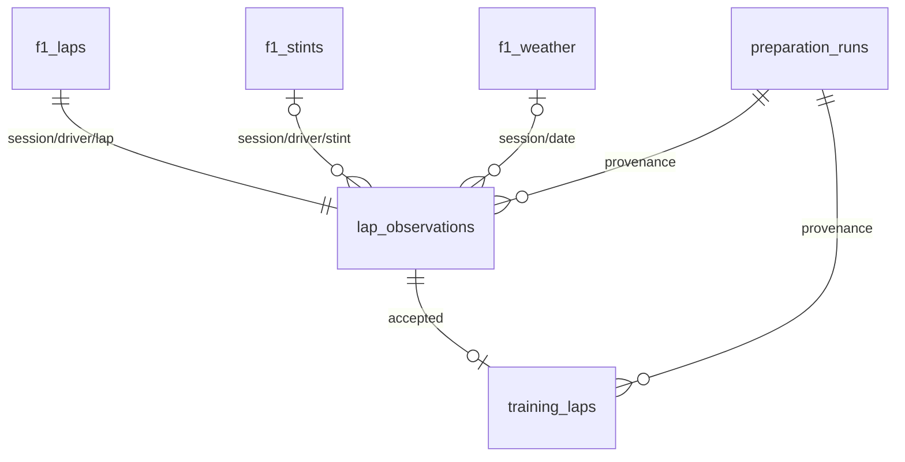

# Подготовка выборки: контракт и ограничения

Прогнозный момент — начало конкретного круга. Цель — его длительность **при условии, что круг оказался обычным и сухим**. Ретроспективный отбор не означает, что до старта можно предсказать будущий Safety Car или пит-стоп.

## Источник и время

Вход читается SQL из `f1.*`: [005_prepare_candidates.sql](../sql/005_prepare_candidates.sql). Файлы выгрузок не служат входом. PostgreSQL работает в UTC. Транзакция `REPEATABLE READ` обеспечивает согласованный снимок; advisory lock предотвращает параллельную замену подготовленных таблиц. Перед подготовкой проверяется наличие всех пяти обязательных источников для выбранных сессий. Таблицы источника остаются без изменений, что проверяется контрольными суммами всех полей.

Документация [OpenF1 / Stints](https://openf1.org/docs/#stints), проверена 14.10.2026: `tyre_age_at_start` — возраст шин на начало **отрезка**, выраженный в завершённых кругах. Поэтому

```text
tyre_age_before_lap = tyre_age_at_start + lap_number - lap_start
```

На начальном круге отрезка прибавляется ноль. У Расселла в сессии 9539: SOFT, круги 1–15, начальный возраст 3 → перед кругом 15 возраст 17; MEDIUM, начало 16, возраст 0 → перед 16 возраст 0, перед 17 возраст 1. Проверяется именно число пройденных кругов, а не физический износ резины. Все шесть реальных примеров записаны в [cleaning.md](../reports/cleaning.md).

Принадлежность отрезку определяется включительно по `lap_start..lap_end` и **по обоим ключам session_key/driver_number**. Число совпадений проверяется до загрузки. Пересечения отрезков прерывают подготовку; прежний набор сохраняется. `lap_end` применяется для сопоставления/аудита и не входит в признаки. Итоговые исторические stints не содержат времени объявления: предполагается, что команда знает состав и начальный возраст при установке шин. Задержки публикации OpenF1 проект не моделирует.

[OpenF1 / Laps](https://openf1.org/docs/#laps) описывает `date_start` как приблизительное время. [Weather](https://openf1.org/docs/#weather) обновляется примерно раз в минуту. Погодный SQL `LATERAL` выбирает максимум `date <= lap_start_at` в той же сессии; будущие записи никогда не используются. Максимальная давность 120 с — заранее заданный порог качества. Timestamp датчика сохраняется; timestamp не доказывает фактическую доступность сообщения API без задержки.

## Правила отбора

Все правила применяются независимо; причины сохраняются отсортированным массивом `exclusion_reasons`. Доли считаются от всех исходных кругов; суммы причин не равны числу исключённых строк из-за пересечений.

| Ситуация | Действие | Основание |
|---|---|---|
| Первый круг | Исключить | Стартовая процедура отличается от обычного темпа |
| Pit-out | Исключить | `is_pit_out_lap=true` |
| Pit-in | Исключить | Следующий круг той же пары session/driver отмечен pit-out **или** начинает следующий stint |
| Неизвестный pit-out | Исключить | Нет достоверного статуса |
| SC/VSC | Исключить пересекающий интервал круг | Состояние по сообщениям race_control |
| RED | Исключить до следующего GREEN на трассе | CLEAR не считается возобновлением после красного флага |
| YELLOW/DOUBLE YELLOW | Исключить пересекающий интервал круг | Состояние отдельного мини-сектора / трассы / пилота |
| BLUE, BLACK AND WHITE, CHEQUERED | Сохранить | Не доказывают ограничение обычного темпа; предупреждения/финиш сами по себе не причина удаления |
| Дождь | Исключить | rainfall=1 на начало или в течение круга; состояние до следующего замера |
| WET/INTERMEDIATE | Исключить | Дождевой состав |
| Нет времени круга / старта | Исключить | Цель/временное сопоставление не восстанавливаются догадками |
| Нет шин, погоды, температуры, имени пилота | Исключить | Не хватает обязательных признаков |
| Время ≤0, NaN/Infinity | Исключить | Невалидная цель, а не медленный результат |
| Возраст <0; температура воздуха вне −20..60 °C или трассы вне −20..80 °C | Исключить | Широкие физические проверки, заданные до обучения |
| Время вне 60..120 с | **Только предупреждение**, сохранить | Диапазон для просмотра, не фильтр качества модели |

Круг — полуоткрытый интервал `[lap_start_at, lap_start_at + lap_duration)`. Событие точно на конце не относится к этому кругу. Состояния race_control также полуоткрытые. Для кругов без цели конец не придумывается: они уже исключены по missing_target; полнота дополнительных причин пересечения для них не гарантируется.

Обработка [Race control](https://openf1.org/docs/#race-control): повторный жёлтый в том же scope не создаёт новую строку круга; CLEAR закрывает соответствующий сектор, GREEN с текстом PIT EXIT не сбрасывает состояния гонки. SC IN THIS LAP / VSC ENDING — предупреждения об окончании, состояние продолжается до последующего CLEAR/GREEN трассы или явного ENDED. Если закрытие отсутствует, интервал консервативно продолжается до конца сессии, `censored=true`. В 2025 году SC DEPLOYED в 14:17:01 UTC → IN THIS LAP в 14:27:16 → TRACK CLEAR в 14:28:21. Жёлтый сектор 12: 14:16:46–14:23:12 UTC. Интервалы и исходные ID сообщений находятся в отчёте и аудите.

Локальный жёлтый исключает все перекрывающиеся по времени круги, поскольку точная позиция автомобиля не используется. Это сознательно консервативная потеря данных, а не доказательство, что каждый пилот видел флаг. Пит-проезд без pit-out и без нового stint может остаться незамеченным. Rainfall=0 не доказывает сухой асфальт; один подозрительный дождевой замер 2024 года сохраняется как есть, а затронутые круги исключаются.

## Отдельные таблицы

- `analytics.preparation_runs`: успешные версии подготовки, параметры, контрольные суммы входа/выхода/кода, метаданные API-batch, результаты проверок. Ошибка откатывает транзакцию; успешный журнал растёт при повторе.
- `analytics.lap_observations`: **все** исходные круги с сопоставлениями, причинами, предупреждениями и ID race_control. Уникальный ключ `(session_key, driver_number, lap_number)`.
- `analytics.training_laps`: только принятые круги, целевая переменная, разрешённые признаки и временные следы проверки. Без текущих секторов, конца круга и причин исключения.

Подготовленные таблицы хранят **текущий** набор: повторный запуск атомарно заменяет их, не добавляя дубли. Журнал хранит контрольные суммы и происхождение предыдущих запусков, но не копии всех прошлых производных строк. Для воспроизведения старого набора требуются исходный снимок PostgreSQL, версия кода и конфигурация.



## Повторение и проверка

```bash
f1-pipeline prepare --verify-repeat
f1-pipeline eda
python scripts/check_notebook.py notebooks/02_preparation_eda.ipynb
```

`repeat_preparation.json` сравнивает вход, полный выход аудита и количества двух **фактических** запусков. Проверяются уникальность, кардинальность, согласование таблиц, FK, формула возраста, timestamp погоды/истории и вариативность по гонкам. `eda` дополнительно проверяет, что исходные данные не менялись после подготовки, и что прошлое время принадлежит тому же пилоту и сессии. Синтетические тесты проверяют будущую погоду, подмену цели/секторов, границы интервалов, SC/VSC/RED, межсессионную историю и атомарный отказ при пересечении stints.

Преобразования с обучаемыми параметрами здесь не применяются. При следующем этапе кодирование, заполнение отсутствующей истории и масштабирование обучаются только на тренировочных гонках. Предварительный план: 2023 train, 2024 validation, 2025 test. История предыдущих кругов доступна для последовательного прогноза перед каждым кругом; для прогноза всей гонки до её начала она недоступна. После изучения EDA финальный 2025 нельзя использовать для выбора модели/порогов.
