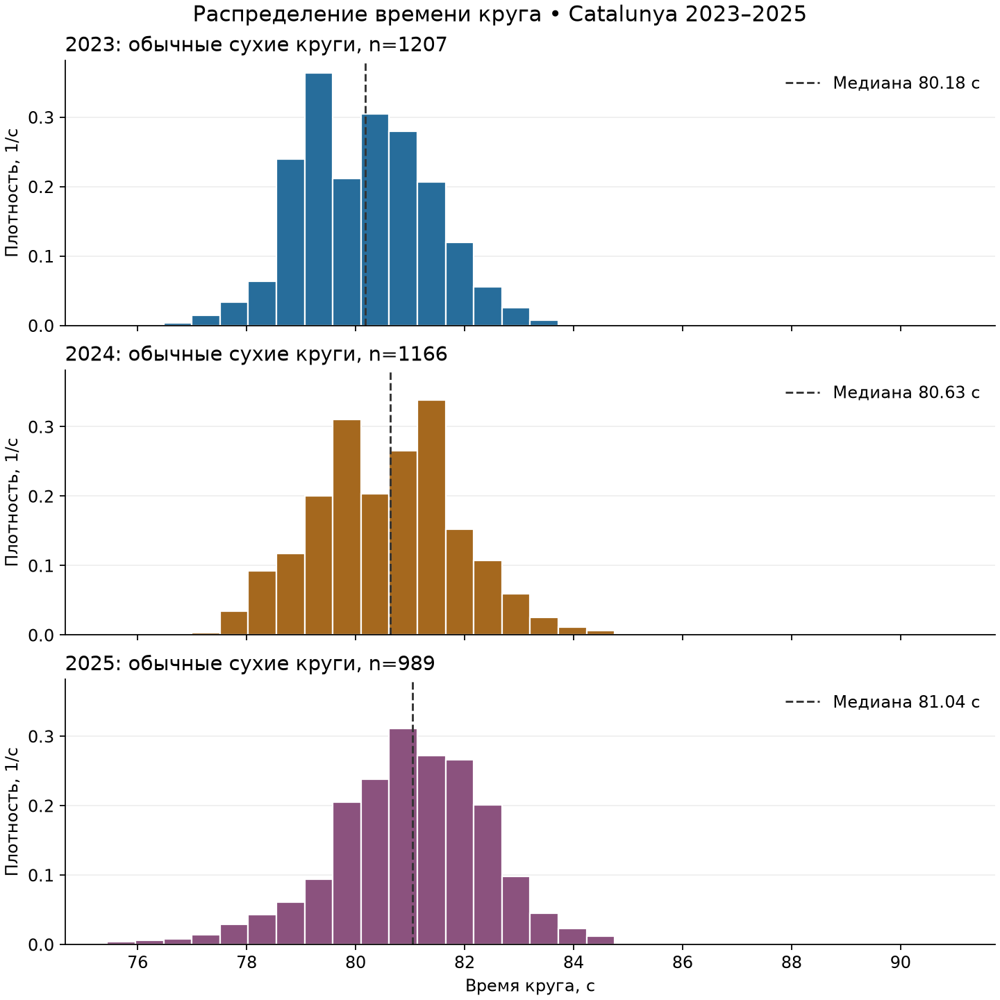
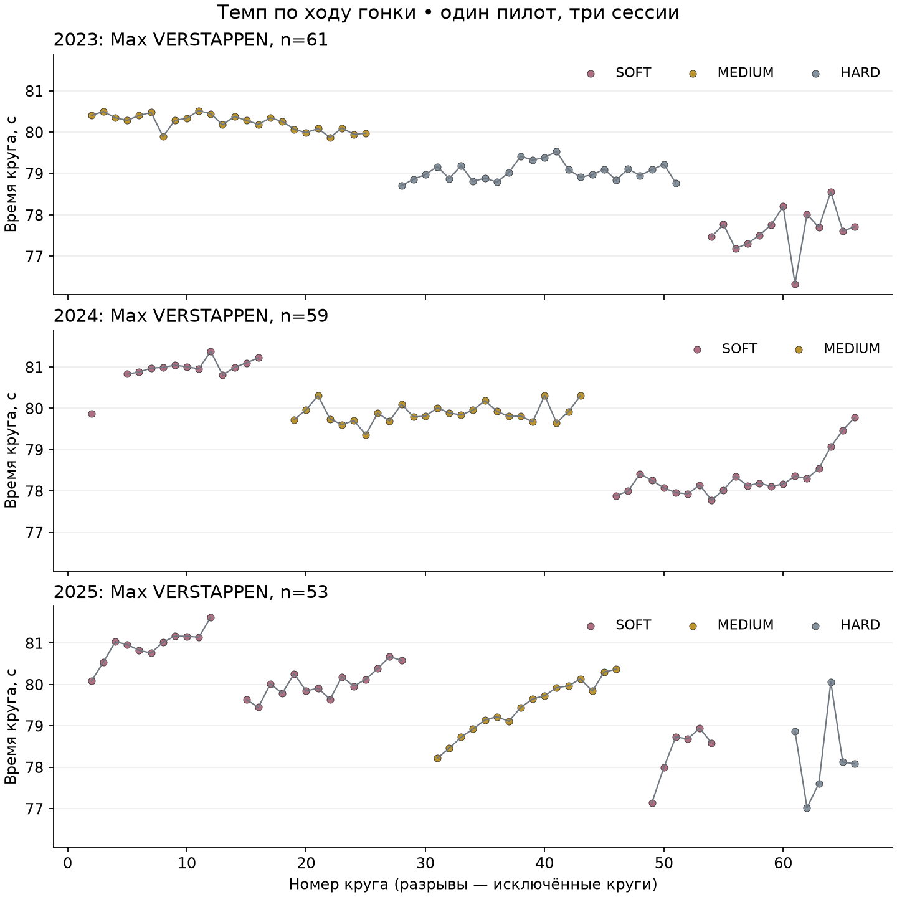
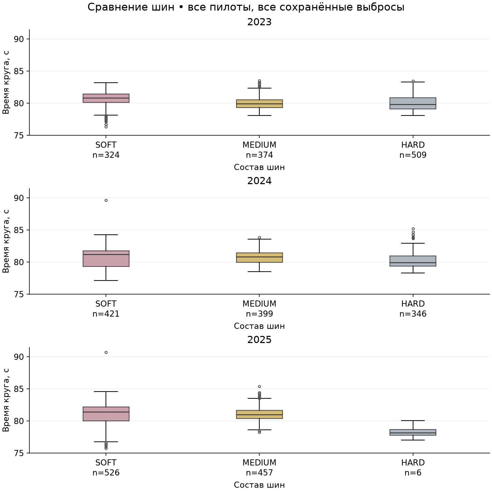
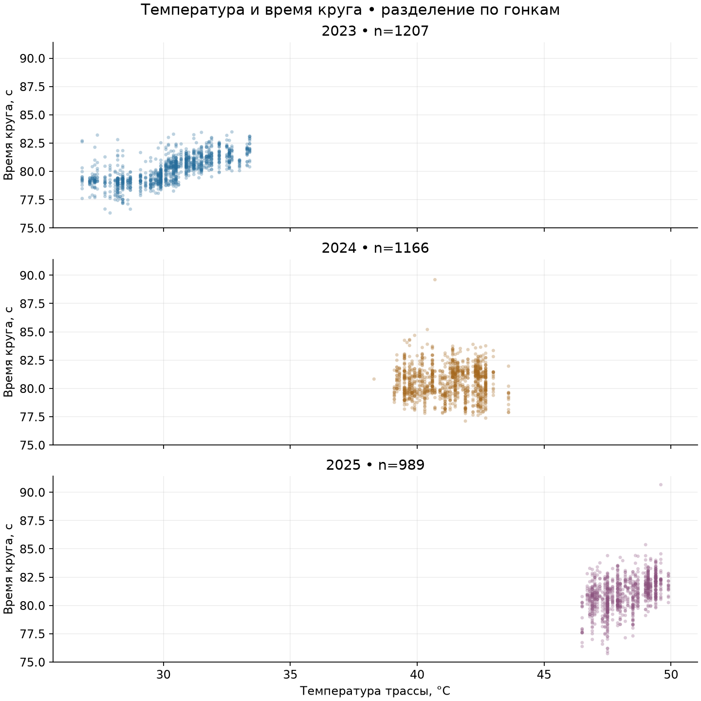

# Исследовательский анализ

Источник: SQL → PostgreSQL `analytics.training_laps`; 3362 обычных сухих кругов Catalunya, 2023–2025. UTC: 2026-10-13 21:46:27.165862+00:00.

Чтение: [006_training_read.sql](../sql/006_training_read.sql). Проверки: [eda.json](eda.json). Очистка: [cleaning.md](cleaning.md).

| Год | n | Медиана, с | Среднее, с | SD, с | Трасса min–max, °C | SD трассы, °C | Pearson температура/время |
|---|---:|---:|---:|---:|---|---:|---:|
| 2023 | 1207 | 80.178 | 80.153 | 1.183 | 26.8–33.4 | 1.604 | 0.703 |
| 2024 | 1166 | 80.631 | 80.584 | 1.333 | 38.3–43.6 | 1.141 | -0.008 |
| 2025 | 989 | 81.043 | 81.007 | 1.432 | 46.5–49.9 | 0.919 | 0.437 |

## Распределение

Гистограммы используют общие интервалы и плотность для сравнения гонок с разным числом кругов. Правый хвост остаётся в выборке: замедления без формальной причины исключения не удаляются. Пунктир — медиана, не прогноз.

## Динамика

Один и тот же пилот позволяет видеть последовательность темпа, составов и разрывов. Разрывы не соединены линиями. Темп зависит одновременно от топлива, трафика и шин; наклон не является оценкой деградации шин.

## Составы шин

Boxplot показывает медиану, квартильный диапазон, усы 1.5 IQR и все точки за усами. Метки n показывают неодинаковое покрытие. Шины применялись на разных этапах гонки и разными пилотами, поэтому сравнение медиан не доказывает преимущество состава.

| Год | Состав | Кругов | Пилотов | Номера кругов | Медиана, с |
|---|---|---:|---:|---|---:|
| 2023 | HARD | 509 | 18 | 2–66 | 79.774 |
| 2023 | MEDIUM | 374 | 15 | 2–66 | 79.867 |
| 2023 | SOFT | 324 | 19 | 2–66 | 80.785 |
| 2024 | HARD | 346 | 13 | 29–66 | 79.869 |
| 2024 | MEDIUM | 399 | 19 | 2–48 | 80.783 |
| 2024 | SOFT | 421 | 20 | 2–66 | 81.143 |
| 2025 | HARD | 6 | 1 | 61–66 | 78.102 |
| 2025 | MEDIUM | 457 | 18 | 2–66 | 80.959 |
| 2025 | SOFT | 526 | 19 | 2–66 | 81.358 |

В 2025 состав HARD представлен всего 6 кругами 1 пилота(ов), на кругах 61–66. Этот малый и смещённый поднабор не позволяет оценить преимущество состава.

## Температура

Каждая точка — круг пилота. Отдельные панели и общие оси показывают, насколько погодные сценарии отличаются между годами. Корреляция описательная: время гонки, топливо и выбор шин связаны с температурой. Повторяющиеся замеры погоды используются многими кругами, число кругов не равно числу независимых погодных наблюдений.

Описательная корреляция температуры трассы и длительности: 2023: r=0.703; 2024: r=-0.008; 2025: r=0.437. Связь неодинакова по гонкам; объединение всех лет скроет это различие.

## Выводы для следующего этапа

- У шин и температур есть вариативность, но только три гонки дают слабую основу для обобщения погоды. Нужны дополнительные сухие гонки той же трассы для более устойчивых выводов.
- Оценивать модель следует по целым гонкам в хронологическом порядке: например, 2023 — обучение, 2024 — проверка выбора модели, 2025 — финальный тест. Случайное перемешивание кругов смешает почти одинаковые условия и завысит качество.
- SOFT/MEDIUM/HARD и имя пилота остаются категориями; никакое кодирование, масштабирование или заполнение пропусков на полном наборе не обучалось.
- Признак предыдущего времени может улучшить прогноз, но отражает также предыдущий pit/SC круг. При финальной гонке он допустим только в последовательном режиме, когда прошлый результат уже известен; для прогноза всей гонки заранее он недоступен.
- Итоговая задача условная: время обычного сухого круга. Классификацию будущих аварий, дождя и пит-стопов модель этого проекта не решает.
